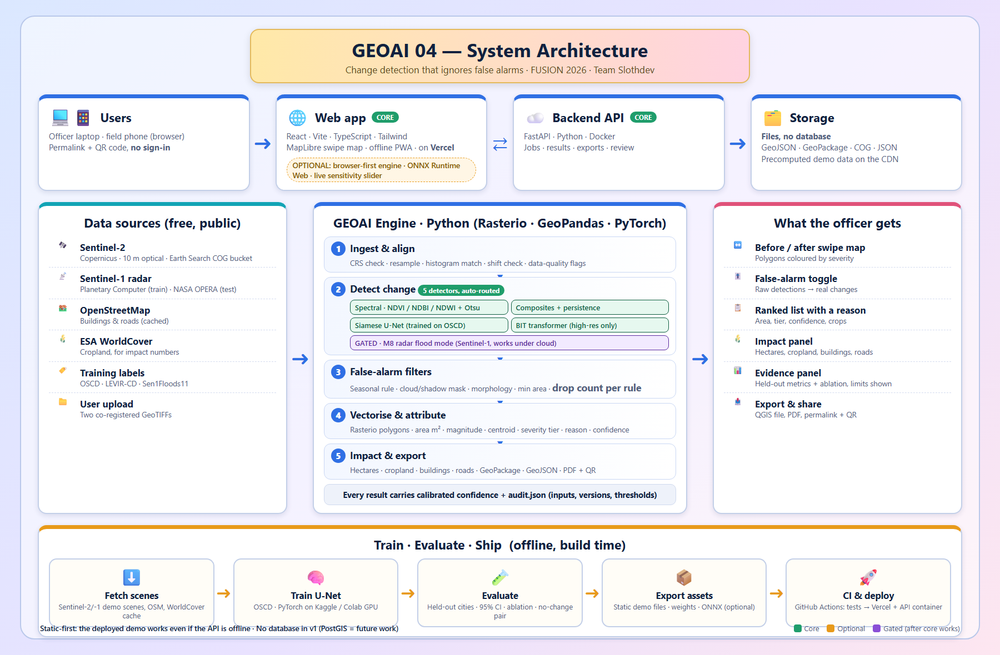

# GEOAI 04: Change Detection that Ignores False Alarms

**FUSION 2026 · GeoAI track · Problem statement GEOAI 04 · Team Slothdevs**

A **web app** that shows what actually changed on the ground between two dates: flooding, new construction, encroachment, vegetation loss. It filters out the seasonal, lighting, cloud and radar-speckle noise that makes naive comparisons useless. Every change comes back as a GIS-ready polygon with its area, a severity tier and a one-line reason, plus an **impact summary** (hectares changed, cropland and built-up land affected).

> **Status (9 Oct 2026):** engine, radar flood mode (M8), API and web app work end to end and are tested. **Submission deadline: 10:00, 10 October 2026.**
>
> Live site: _to be added_ · API: _to be added_ · Demo video: _to be added_

## The problem

After a flood or a construction boom, agencies compare satellite images from two dates. Most pixel-level change is not real: crops grow, seasons turn, the sun moves, clouds pass, radar speckles. Naive differencing floods analysts with false alarms, and a raw pixel mask isn't something a GIS team can act on.

## What the site does

1. **Pick a scene, or analyse any area:** seven demo scenes (four tuned: Assam flood on radar, Navi Mumbai airport build-out, Pune city edge, a farmland season control; three **regional checks**: Delhi NCR, Bengaluru, Guwahati); or **draw a box anywhere in India** on the map, choose two dates, and the server fetches the two clearest Sentinel-2 images and runs the engine; or upload your own GeoTIFFs; or upload one Sentinel-1 radar image for a flood.
2. **Swipe map:** before/after compare with change polygons coloured by severity tier.
3. **The demo moment:** toggle the false-alarm filter. Navi Mumbai: **2,185 raw detections → 265 real changes**; Assam flood (radar): **3,490 → 37**; the season control, where nothing was built: **3,083 → 22**.
4. **Explore:** ranked list, detail card with area, confidence, location, the **reason it was kept** and before/after crops; confirm or dismiss each change.
5. **Impact:** hectares changed, cropland and built-up land affected (ESA WorldCover), each with its source and caveats. Unknown is shown as "unknown", never as zero.
6. **Export:** GeoPackage, GeoJSON (all or confirmed only), one-page PDF, CSV field pack with map links, KML, audit trail; permalink + QR code for phones. A live analysis opens on the same swipe map as the demo scenes.
7. **Accuracy page:** every number comes from a results file in this repo.

**Works offline:** after one visit the site and the demo scenes are cached (PWA, about 14 MB), so the demo opens with no network. Live analysis needs the API.

**Sensitivity lab:** on the optical scenes, drag the change threshold and the smallest-change slider and watch the detections change live in the browser (the same filters as the server, proven equal by a test).

**What it does not do:** 10 m imagery cannot see people or single small buildings. The site **prioritises where to look**.

### Does it work for all of India?

The engine is region-agnostic (Sentinel-2 covers the whole country) and any box up to about 15 × 15 km can be analysed. **What we have checked so far:**
- Scene selection against the live archive for Delhi NCR, Jaipur, Chennai, Kochi, Guwahati and Bengaluru: a clear scene was found for each.
- **Full pipeline on six regions, each reviewed by eye** (`eval/regions.py`, pictures in `docs/img/qa_region_*.jpg`): Delhi NCR, Jaipur, Chennai, Kochi, Guwahati, Bengaluru. Fast-growing urban areas look plausible. **Known confusers:** rivers and sandbars move between dates and are flagged (the Yamuna in Delhi, the Brahmaputra at Guwahati); bare soil in dry regions (Jaipur) produces scattered small detections. Three of these are published as demo scenes, labelled "Regional check".
- Visual checks of the change polygons on four tuned scenes (Navi Mumbai, Pune, a farmland control in Maharashtra, Assam radar), see `docs/img/qa_*.jpg`.

The detection thresholds were tuned on the Maharashtra scenes. **We have not yet validated the results in other regions, so we do not claim it works everywhere.** Bigger areas need tiling, which is not built.

## Measured results

| Check | Naive | Ours |
|---|---|---|
| Radar flood (M8), Sen1Floods11 **unseen country** (Bolivia), flood IoU | 0.337 | **0.697** |
| Radar flood (M8), India test chips, flood IoU | 0.273 | **0.571** |
| Radar flood (M8), Sen1Floods11 official test split, flood IoU | 0.141 | **0.287** (0.433 with the optional learned classifier) |
| Optical false alarms on the season-control scene (no real construction), per km² | 86.9 | **0.62** |

The thresholds were fitted without labels, and the held-out splits were never used for fitting. The ablation (`eval/ablation.py`) shows the change-type rules and the speckle filter do almost all the false-alarm removal. **Optional extra filters, measured** (`eval/composites.py`): requiring a change to appear in a second, later image cut detections on a no-construction control area by 27% (11 to 8 polygons) but also removed about 15% of the changed area on a real-construction area (Pune, 142 to 121 ha); median composites of 3 images did not reduce false alarms. Both are therefore **off by default**. One test area each: a measurement, not a guarantee. **Not measured yet:** optical accuracy against labels (OSCD), and before/after radar change on 2026 NASA OPERA data. Details: [`eval/README.md`](eval/README.md), [`docs/M8_RADAR_FLOOD_DATA.md`](docs/M8_RADAR_FLOOD_DATA.md).

## Model status

| Mode | Input | Method | Status |
|---|---|---|---|
| Spectral | Sentinel-2 (≥ 4 bands incl. NIR, ≥ 5 m) | NDVI / NDBI / NDWI / SWIR-blue change vector, Otsu, type rules, false-alarm filters | **Working**, used by 3 demo scenes and live uploads |
| Radar flood (M8) | Sentinel-1 VV/VH dB | Event-level threshold + region growing, JRC permanent-water mask, morphology | **Working**, evaluated on Sen1Floods11 |
| Learned (M8) | Sentinel-1 | Gradient-boosted pixel classifier (`engine/weights/m8_gbm.joblib`) | Optional; better on the test split, worse on Bolivia |
| OSCD-trained model | Sentinel-2 | Siamese U-Net in PyTorch, served with ONNX | **In progress** (not in this build) |
| BIT deep model | High-res RGB (0.5 m) | Siamese transformer, evaluated on LEVIR-CD | Planned |

## Architecture



_The same diagram, with every layer marked built, in progress or optional, is on the site's About page._


```
 Web app (React + Vite + MapLibre)           static demo files            FastAPI (api/main.py)
 scenes · swipe map · filter toggle   ◀── web/public/demos/<id> ──    /demos  /analyze  /jobs  /metrics
 ranked list · impact · review                                        engine/: ingest → detect → filter →
 exports · accuracy page              ──── HTTP/JSON (optional) ──▶     vectorise → attributes → impact → export
```

The site is **static-first**: the demo works with the API switched off. The API adds live uploads.

## Tech stack

| Part | Stack |
|---|---|
| Web app | React 19, Vite 7, TypeScript, Tailwind CSS 4, MapLibre GL, Zustand, React Router, vite-plugin-pwa (offline); Vitest + Testing Library, Playwright |
| Engine and API | Python 3.11, FastAPI, Rasterio (GDAL), GeoPandas, Shapely, pyproj, NumPy, SciPy, scikit-image, scikit-learn, fpdf2, qrcode, mgrs; pytest, ruff |
| Deep learning | PyTorch (OSCD Siamese U-Net, in progress), ONNX Runtime (serving) |
| Data | Sentinel-2 L2A (public COGs), Sentinel-1 via Sen1Floods11, ESA WorldCover 2021, JRC Global Surface Water |
| Deployment | Vercel (web, `web/vercel.json`), one Docker container for the API + site (`Dockerfile`, port 7860), GitHub Actions CI |

## Repository layout

```
api/        FastAPI service (routes in BACKEND_PLAN.md §6)
engine/     change engine: s2, aoi (any area), ingest, change_spectral, composite, persistence, filters, vectorise, attributes, impact, quality, export, preview, report, radar, run
web/        React app; web/public/demos = precomputed demo scenes; web/e2e = Playwright
eval/       results.json, ablation.py, build_results.py, results/ (M8 experiments)
ml/         M8 experiments on the official Sen1Floods11 splits
scripts/    fetch demo scenes, build demo assets, fetch M8 chips, qa_overlay (visual check), clean_clone_check (pre-submission check)
tests/      pytest (engine, any-area, composites, radar, API)
prototype/  round-1 pipeline and static prototype
docs/       plans, research, UI speaking guide
```

## Run it

```bash
# API + engine (Python 3.11+)
pip install -r requirements.txt
uvicorn api.main:app --port 8000

# Web app
cd web && npm install && npm run dev          # set VITE_API_URL=http://localhost:8000 for live uploads

# One container (API + built site), as on a Hugging Face Docker Space; see docs/DEPLOY.md
docker build -t geoai04 . && docker run -p 7860:7860 geoai04

# Command line
python -m engine.run demos/navi-mumbai-airport/before.tif demos/navi-mumbai-airport/after.tif \
  --out out/airport --preset encroachment --before-date 2019-01-13 --after-date 2024-12-17
python -m engine.run chip.tif --mode radar --out out/flood
```

Rebuild the data: `python scripts/fetch_demo_scenes.py` → `python scripts/export_demo_assets.py` → `python eval/ablation.py` → `python eval/build_results.py`.

## Tests

```bash
ruff check . && pytest -q                                            # 92 tests
cd web && npm run lint && npm run typecheck && npm test && npm run build && npm run e2e   # 39 unit tests, 4 end-to-end tests (including offline)
python scripts/clean_clone_check.py                                  # fresh clone, fresh environment, every check
```

CI runs all of these on every push (`.github/workflows/ci.yml`).

## Documents

| Read this | For |
|---|---|
| [`BACKEND_PLAN.md`](BACKEND_PLAN.md) · [`FRONTEND_PLAN.md`](FRONTEND_PLAN.md) | What was built and why, API contract, tests, deployment |
| [`docs/DECISIONS.md`](docs/DECISIONS.md) · [`docs/packages/`](docs/packages/CONTRACTS.md) | **Decisions made and the two work packages (models vs product) with their interfaces** |
| [`docs/PITCH_BRIEF.md`](docs/PITCH_BRIEF.md) | Speaker brief: built, next, stack and why |
| [`docs/UI_EXPLANATION.md`](docs/UI_EXPLANATION.md) | Walkthrough of the UI for presenting |
| [`docs/DEPLOY.md`](docs/DEPLOY.md) | Deploying the site (Vercel) and the API (Hugging Face Space or Render) |
| [`docs/M8_RADAR_FLOOD_DATA.md`](docs/M8_RADAR_FLOOD_DATA.md) | Radar flood mode: data, access, evidence |
| [`docs/PROJECT_PLAN.md`](docs/PROJECT_PLAN.md) · [`docs/TASK_SPLIT.md`](docs/TASK_SPLIT.md) · [`docs/TECH_OPTIONS.md`](docs/TECH_OPTIONS.md) | Full plan, schedule, options compared |
| [`docs/PRIOR_ART_TECH_STACKS.md`](docs/PRIOR_ART_TECH_STACKS.md) | What past projects built and the gaps we close |

## Credits

- Sentinel-2 and Sentinel-1 imagery: Copernicus programme (ESA), Sentinel-2 COGs via Element84 Earth Search
- Sen1Floods11 (Bonafilia et al., CVPR Workshops 2020), CC-BY 4.0; JRC Global Surface Water (Pekel et al., 2016)
- ESA WorldCover 2021 v200, CC-BY 4.0
- Map data © OpenStreetMap contributors
- Round-1 prototype: BIT model ([justchenhao/BIT_CD](https://github.com/justchenhao/BIT_CD)), LEVIR-CD dataset (**academic use only; commercial use prohibited; Google Earth imagery terms apply**)
- OSCD, Onera Satellite Change Detection dataset (Daudt et al., 2018), used for the in-progress learned model
