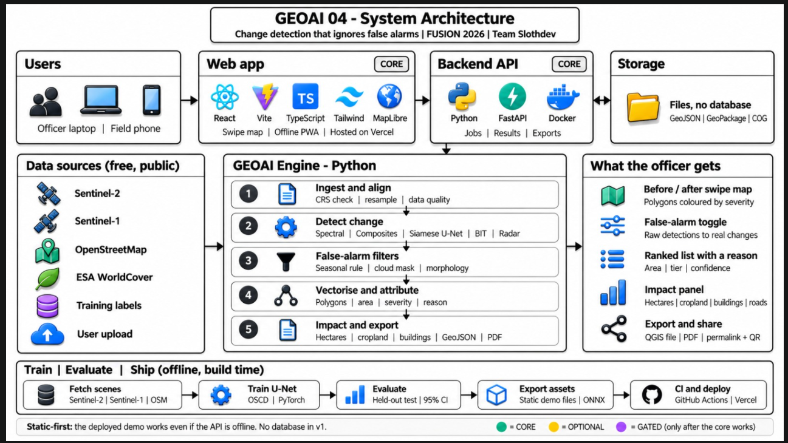

# GEOAI 04: Change Detection that Ignores False Alarms

**FUSION 2026 · GeoAI track · Problem statement GEOAI 04 · Team Slothdevs**

A **web app** that shows what actually changed on the ground between two dates: flooding, new construction, encroachment, vegetation loss. It filters out the seasonal, lighting, cloud and radar-speckle noise that makes naive comparisons useless. Every change comes back as a GIS-ready polygon with its area, a severity tier and a one-line reason, plus an **impact summary** (hectares changed, cropland and built-up land affected).

> **Status (10 Oct 2026):** engine, four detector modes, radar flood mode, API and web app work end to end, are tested and are deployed.
>
> | | |
> |---|---|
> | Live site | **https://geoai04.onrender.com** (first load can take about a minute: free hosting sleeps when idle) |
> | Live API | same address: `/health`, `/demos`, `/analyze`, `/fetch-s2` |
> | Demo video | **TODO: add the YouTube link** |
> | Presentation | [`PPT/FUS_016_GEO_AI_04_SlothDev.pptx`](PPT/FUS_016_GEO_AI_04_SlothDev.pptx) |



_Architecture in one picture._

## The problem

After a flood or a construction boom, agencies compare satellite images from two dates. Most pixel-level change is not real: crops grow, seasons turn, the sun moves, clouds pass, radar speckles. Naive differencing floods analysts with false alarms, and a raw pixel mask isn't something a GIS team can act on.

## What the site does

1. **Pick a scene, or analyse any area.** Nine demo scenes (see below); or **draw a box anywhere in India** on the map, choose two dates, and the server fetches the two clearest Sentinel-2 images and runs the engine; or upload your own GeoTIFFs; or upload one Sentinel-1 radar image for a flood. Dates are checked: the before date must be earlier than the after date.
2. **Swipe map.** Before/after compare with change polygons coloured by severity tier.
3. **The demo moment.** Toggle the false-alarm filter. Navi Mumbai: **2,185 raw detections → 265 real changes**; Assam flood (radar): **3,490 → 37**; the farmland season control, where no large construction is expected: **3,083 → 22**.
4. **Choose the detector.** On scenes with precomputed variants (Navi Mumbai, Pune, Saswad, Madhya Pradesh, Bihar) a detector switch compares the spectral rules, the learned model and the hybrid on the same pair. The Analyse page offers the same choice for live analysis; it greys out a mode the server cannot run and says why.
5. **Explore.** Ranked list, detail card with area, confidence, location, the **reason it was kept** and before/after crops; confirm or dismiss each change.
6. **Sensitivity lab.** On the optical scenes, drag the change threshold and the smallest-change slider and watch the detections change live in the browser (the same filters as the server, proven equal by a test).
7. **Impact.** Hectares changed, cropland and built-up land affected (ESA WorldCover), each with its source and caveats. Unknown is shown as "unknown", never as zero.
8. **Export.** GeoPackage, GeoJSON (all or confirmed only), one-page PDF, CSV field pack with map links, KML, audit trail (`audit.json`: inputs, versions, thresholds); permalink + QR code for phones. A live analysis opens on the same swipe map as the demo scenes.
9. **Accuracy page.** Every number comes from `eval/results.json`, with the limits next to it.

**Works offline.** After one visit the site and the demo scenes are cached (PWA), so the demo opens with no network. Live analysis needs the API.

**Look.** Two themes: **Midnight Terrain** (dark, the default) and **Daylight GIS** (light), with a switch that remembers your choice or follows the system setting. Keyboard and contrast checks run in the end-to-end tests (axe).

**What it does not do.** 10 m imagery cannot see people or single small buildings. The site **prioritises where to look**.

### Demo scenes

| Scene | Kind |
|---|---|
| Assam flood 2016 | Radar flood (Sentinel-1) |
| Navi Mumbai airport build-out | Optical, large construction |
| Pune city edge (Hinjewadi) | Optical, city-edge construction |
| Saswad farmland | **Season control**: nothing large was built, so detections are mostly false alarms |
| Madhya Pradesh (Bhopal lake and fringe), Bihar (Patna Ganga floodplain) | Optical encroachment scenes added late; **not part of the measured results below** |
| Delhi NCR (Noida), Bengaluru (Whitefield), Guwahati | **Regional checks**: the full pipeline on other regions, reviewed by eye |

### Does it work for all of India?

The engine is region-agnostic (Sentinel-2 covers the whole country) and any box up to about 15 × 15 km can be analysed. **What we have checked so far:**
- Scene selection against the live archive for Delhi NCR, Jaipur, Chennai, Kochi, Guwahati and Bengaluru: a clear scene was found for each.
- **Full pipeline on those six regions, each reviewed by eye** (`eval/regions.py`, pictures in `docs/img/qa_region_*.jpg`). Fast-growing urban areas look plausible. **Known confusers:** rivers and sandbars move between dates and are flagged (the Yamuna in Delhi, the Brahmaputra at Guwahati); bare soil in dry regions (Jaipur) produces scattered small detections. Three of these are published as "Regional check" demo scenes.
- Visual checks of the change polygons on the four tuned scenes (Navi Mumbai, Pune, Saswad, Assam), see `docs/img/qa_*.jpg`.

The spectral engine's thresholds were tuned on the Maharashtra scenes. The learned model was scored on 10 held-out OSCD locations on four continents and is weak in three of them, **so we do not claim it works everywhere.** Bigger areas need tiling, which is not built.

## Detector modes

| Mode | Input | Method | Status |
|---|---|---|---|
| `spectral` (**default**) | Sentinel-2 (≥ 4 bands incl. NIR, ≥ 5 m) | NDVI / NDBI / NDWI / SWIR-blue change vector, Otsu, change-type rules, false-alarm filters | **Working.** The safe default |
| `learned` | Sentinel-2, 10 m | Siamese U-Net (1.09 M parameters) trained on OSCD with PyTorch, **served with ONNX Runtime** (no PyTorch needed on the server) | **Working.** Higher F1 on OSCD, but more false alarms on farmland (see below) |
| `hybrid` | Sentinel-2, 10 m | The learned model proposes; a candidate must also have a real spectral change type | **Working.** Fewer farmland false alarms; can also remove real change (recall 0.03 on the three OSCD validation cities) |
| `deep` | **RGB at about 0.5 m only** | BIT, the Bitemporal Image Transformer, with the authors' LEVIR-CD weights | **Working** where PyTorch is installed and `scripts/fetch_bit.py` has been run; unavailable on the default light server. Engine and API only: the Analyse page does not offer it |
| `radar` (M8) | Sentinel-1 VV dB | Event threshold, region growing, permanent-water mask, morphology | **Working**, evaluated on Sen1Floods11; open-water flood extent from one date |

Optional learned radar classifier (gradient boosting, `engine/weights/m8_gbm.joblib`): better on the official test split, worse on unseen places, so it is not the default.

`/health` reports which modes this server can run, and a mode that cannot run fails with a plain reason, never a crash. Optional filters, **off by default** (`eval/composites.py`): requiring a change to appear in a second later image, and median composites of several images.

**Why the default is still `spectral`.** On OSCD the learned model scores higher, and `eval/results.json` marks it as the measured best method. But on our no-construction farmland scene it raises about 12 times more polygons than the spectral rules, and it was trained only on urban change. We offer both, show both numbers, and default to the one with fewer false alarms.

## Measured results

Every figure below comes from `eval/results.json` (regenerated by `eval/build_results.py`) or the file named beside it.

**Radar flood mode (M8), Sen1Floods11, flood-only IoU, thresholds fitted without labels**

| Check | Naive | Ours |
|---|---|---|
| Unseen country (Bolivia) | 0.337 | **0.697** |
| India test chips | 0.273 | **0.571** |
| Official test split | 0.141 | **0.287** (0.433 with the optional learned classifier) |
| Assam demo scene, all 68 chips (not held-out: same chips used to fit the threshold) | 0.175 | 0.410 |

Single-date open-water mapping. Flooded crops and streets can be missed; recall is moderate by design (precision 0.79 on the Assam chips).

**Optical change, 10 held-out OSCD locations (4 continents), 95 % bootstrap intervals**

| Method | F1 | Precision | Recall |
|---|---|---|---|
| Plain subtraction | 0.24 [0.08, 0.45] | 0.15 | 0.60 |
| Spectral rules | 0.38 [0.13, 0.52] | 0.57 | 0.29 |
| **Learned (Siamese U-Net)** | **0.54 [0.34, 0.66]** | 0.45 | 0.67 |

The learned model beats the spectral rules in all 10 locations and plain subtraction in all 10, but is **weak (F1 below 0.25) in three: Valencia, Norcia and Saclay**. Calibration error 0.076. Context: published frozen-backbone baselines on OSCD score roughly F1 41 to 53.

**Very-high-resolution buildings, BIT on the full LEVIR-CD test split (128 images):** F1 **0.90 [0.89, 0.91]**, IoU 0.82, against 0.89 published (Chen, Qi, Shi 2021); the published figure is reproduced, not beaten. Plain subtraction scores 0.14.

**False alarms (spectral engine, encroachment preset)**

| Scene | Raw detections | Kept | Kept per km² |
|---|---|---|---|
| Saswad farmland, **season control** | 3,083 | **22** | 0.62 (naive: 86.9) |
| Navi Mumbai airport | 2,185 | 265 | 7.42 |
| Pune city edge | 6,830 | 475 | 8.35 |

The control scene is farmland a few months apart where no large construction is expected. Its remaining 22 detections are **not ground-verified**, so read 0.62 per km² as an upper bound on the false-alarm rate, not a measured one. The ablation (`eval/ablation.py`) shows the change-type rules and the speckle filter do almost all the removal.

**Detector modes on the same scenes (polygons kept)**

| Scene | Spectral | Learned | Hybrid |
|---|---|---|---|
| Saswad farmland (no real change) | 22 | 263 | 12 |
| Navi Mumbai airport (large construction) | 265 | 119 | 69 |
| Pune city edge (construction) | 475 | 599 | 305 |

**Speed:** spectral 0.025 s per km², learned 0.003 s per km², deep 2.2 s per km².

**Radar before/after on a July 2024 Assam event** (Planetary Computer `sentinel-1-rtc`, parameters frozen, not tuned on it): 977 polygons, 56.4 km² of new open water against three dry-season reference scenes; on a dry-season control pair the same method raises 29 false polygons (0.065 per km²) against 230 (0.515 per km²) for single-date mapping. This is open-water extent against a stated reference for one event, **not a general accuracy claim and not scored against hand labels**.

**Optional filters, measured** (`eval/composites.py`): requiring a change to appear in a second, later image cut detections on the no-construction control by 27 % (11 to 8 polygons) but also removed about 15 % of the changed area on a real-construction area (Pune, 142 to 121 ha); median composites of 3 images did not reduce false alarms. One test area each: a measurement, not a guarantee.

**Not measured yet:** radar before/after on NASA OPERA RTC-S1 2026 events (needs an Earthdata login; a Planetary Computer event is measured instead). Details: [`eval/README.md`](eval/README.md).

## Architecture

```
 Web app (React + Vite + MapLibre)           static demo files            FastAPI (api/main.py)
 scenes · swipe map · filter toggle   ◀── web/public/demos/<id> ──    /demos  /analyze  /fetch-s2  /jobs  /metrics
 detector switch · sensitivity lab                                    engine/: ingest → detect (5 modes) → filter →
 ranked list · impact · review                                        vectorise → attributes → impact → export
 exports · accuracy page · offline    ──── HTTP/JSON (optional) ──▶     ONNX Runtime serves the learned model
```

The site is **static-first**: the demo works with the API switched off, and as an offline PWA. The API adds live analysis (any area, uploads, radar). There is no database; results are files.

## Tech stack

| Part | Stack |
|---|---|
| Web app | React 19, Vite 7, TypeScript, Tailwind CSS 4, MapLibre GL, Zustand, React Router, vite-plugin-pwa (offline); Vitest + Testing Library, Playwright, axe-core |
| Engine and API | Python 3.11, FastAPI, Rasterio (GDAL), GeoPandas, Shapely, pyproj, NumPy, SciPy, scikit-image, scikit-learn, fpdf2, qrcode, mgrs; pytest, ruff |
| Deep learning | PyTorch (training the OSCD Siamese U-Net; the optional BIT mode), **ONNX Runtime (serves the learned model)** |
| Data | Sentinel-2 L2A (public COGs), Sentinel-1 (Sen1Floods11, Planetary Computer), ESA WorldCover 2021, JRC Global Surface Water; OSCD, LEVIR-CD for the optical models |
| Deployment | **Render**: one Docker container serves the API and the built site (`Dockerfile`, `render.yaml`), deployed from `main`; GitHub Actions CI. Vercel (`vercel.json`) is configured as an alternative for the site |

## Repository layout

```
api/        FastAPI service (routes in BACKEND_PLAN.md §6)
engine/     the change engine: s2, aoi (any area), ingest, detectors (registry), change_spectral, change_learned, change_deep,
            composite, persistence, filters, vectorise, attributes, impact, quality, sensitivity, export, preview, report, radar, run
            weights/ holds the learned U-Net and its ONNX file (committed); BIT's checkpoint is downloaded by script
web/        React app; web/public/demos = precomputed demo scenes; web/e2e = Playwright
eval/       results.json, ablation.py, composites.py, regions.py, build_results.py, results/ (experiments)
ml/         training and experiments (OSCD U-Net, BIT evaluation, radar on the official Sen1Floods11 splits)
scripts/    fetch and build demo scenes, export detector variants, system_test, clean_clone_check, fetch_bit
tests/      pytest (engine, any-area, composites, radar, detector modes, API)
prototype/  round-1 pipeline and static prototype
frontend/   Expo (React Native Web) front-end, built in parallel with web/; the deployed site is web/
PPT/        the team presentation
docs/img/   the architecture diagram and the pictures from the regional review
```

## Run it

```bash
# API + engine (Python 3.11+)
pip install -r requirements.txt                  # includes onnxruntime, so the learned model runs
uvicorn api.main:app --port 8000
# Optional: training, and the deep (BIT) mode
pip install -r requirements.txt -r requirements-ml.txt && python scripts/fetch_bit.py

# Web app
cd web && npm install && npm run dev          # set VITE_API_URL=http://localhost:8000 for live analysis

# One container (API + built site), as deployed on Render (also works as a Hugging Face Docker Space)
docker build -t geoai04 . && docker run -p 7860:7860 geoai04

# Command line (modes: auto, spectral, radar)
python -m engine.run demos/navi-mumbai-airport/before.tif demos/navi-mumbai-airport/after.tif \
  --out out/airport --preset encroachment --before-date 2019-01-13 --after-date 2024-12-17
python -m engine.run chip.tif --mode radar --out out/flood
```

Rebuild the data: `python scripts/fetch_demo_scenes.py` → `python scripts/export_demo_assets.py` → `python scripts/export_detector_variants.py` → `python eval/ablation.py` → `python eval/build_results.py`.

## Tests

Checked on 10 Oct 2026:

```bash
ruff check . && pytest -q                                            # 221 tests
cd web && npm run lint && npm run typecheck && npm test && npm run build && npm run e2e
                                                                     # 137 unit tests in 20 files; end-to-end: demo flow, offline,
                                                                     # accessibility (axe), responsive layouts
uvicorn api.main:app --port 8010 &                                   # black-box test of a running server:
python scripts/system_test.py http://127.0.0.1:8010                  #   287 checks (add --live for real Sentinel-2 lookups)
python scripts/clean_clone_check.py                                  # fresh clone, fresh environment, every check
```

CI runs the first two on every push (`.github/workflows/ci.yml`).

## Documents

| Read this | For |
|---|---|
| [`PPT/FUS_016_GEO_AI_04_SlothDev.pptx`](PPT/FUS_016_GEO_AI_04_SlothDev.pptx) | The team presentation (NETRA) |
| [`BACKEND_PLAN.md`](BACKEND_PLAN.md) | The backend: what was built and why, API contract, tests, deployment |
| [`FRONTEND_PLAN.md`](FRONTEND_PLAN.md) | The web app: screens, components, behaviour |
| [`eval/README.md`](eval/README.md) | Every measured result and the command that reproduces it |
| [`frontend/README.md`](frontend/README.md) | The Expo (React Native Web) front-end |

## Credits

- Sentinel-2 and Sentinel-1 imagery: Copernicus programme (ESA), Sentinel-2 COGs via Element84 Earth Search; Sentinel-1 RTC via the Microsoft Planetary Computer
- Sen1Floods11 (Bonafilia et al., CVPR Workshops 2020), CC-BY 4.0; JRC Global Surface Water (Pekel et al., 2016)
- ESA WorldCover 2021 v200, CC-BY 4.0
- Map data © OpenStreetMap contributors
- BIT change-detection model (Chen, Qi, Shi, IEEE TGRS 2021; [justchenhao/BIT_CD](https://github.com/justchenhao/BIT_CD)), used with the authors' LEVIR-CD weights, fetched by `scripts/fetch_bit.py`
- LEVIR-CD dataset (Chen & Shi, Remote Sensing 2020; official page <https://justchenhao.github.io/LEVIR/>): **academic use only; commercial use prohibited; Google Earth imagery terms apply**. We evaluated BIT on the 128-image test split (copy from the Hugging Face dataset `satellite-image-deep-learning/LEVIR-CD`)
- OSCD, Onera Satellite Change Detection dataset (Daudt et al., 2018), used to train and evaluate the learned model: images and train labels from <https://www.kaggle.com/datasets/soumikrakshit/onera-satellite-change-detection-dataset>, the 10 test-location labels from the Hugging Face dataset `hkristen/oscd` (the Kaggle copy does not include them); licence not stated in the files
