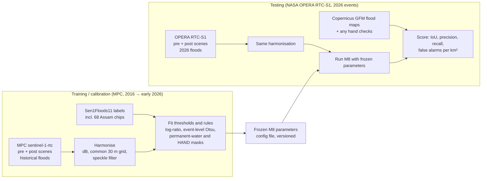

# M8 — Sentinel-1 Radar Flood Mode: Data Sourcing Decision

**Team:** Slothdevs · **Problem statement:** FUSION 2026 GEOAI 04
**Branch:** `backend-2` (owner: Ayush; `backend-1` is Soham's)
**Document date:** 2026-10-09
**Status:** ✅ **Solved: data sourcing decided.** One live check remains (§8) before the first code lands.

> **Decision in one line:** **training / calibration data comes from Microsoft Planetary Computer** (`sentinel-1-rtc`, archive 2014 → April 2026). **Testing data comes from NASA OPERA RTC-S1** (via ASF, global land since 2016 and current through 2026), because Planetary Computer does not yet have the 2026 scenes.

---

## 1. What M8 is and why it matters

M8 is the **radar flood mode** from our method ranking (also listed as addition **A12** in `docs/PROJECT_PLAN.md`).

- **The problem it solves:** optical imagery (Sentinel-2) can't see through clouds. In India, floods happen during the monsoon, exactly when the sky is covered. An optical-only tool goes blind in the one season a flood tool is needed most.
- **The idea:** Sentinel-1 is a radar satellite. Radar sees through clouds, day and night. Calm open water reflects the radar pulse away from the satellite, so **new water shows up as a sharp drop in backscatter** between a "before" and an "after" image.
- **Why it stands out:** none of the nine prior projects we surveyed (`docs/PRIOR_ART_TECH_STACKS.md`) uses Sentinel-1 for floods in a working pipeline. P5 and P8 only mention it or plan it. Disaster authorities in Assam, Bihar and Kerala would get flood extent during the monsoon itself.

**Earlier score in our ranking table:**
- Unique 4 · Reliable **2 (access unverified)** · Result quality 5 for floods · Effort 4
- The low reliability score was because we hadn't confirmed we could get analysis-ready radar data. This document closes that gap.

---

## 2. The decision

| Role | Source | Collection / product | Time span we use | Why |
|---|---|---|---|---|
| **Training / calibration** | **Microsoft Planetary Computer (MPC)** | `sentinel-1-rtc` (radiometrically terrain corrected, from Sentinel-1 GRD) | Historical flood events **2016 → early 2026** | Free, **no account or key needed** (anonymous token), global archive from Oct 2014, analysis-ready (terrain correction already done), Python tooling (`pystac-client` + `planetary-computer`) |
| **Testing** | **NASA OPERA RTC-S1** (distributed by ASF) | `OPERA_L2_RTC-S1` | **2026 flood events** (and any held-out events after the training cut-off) | Has the 2026 scenes MPC is missing; global land coverage since April 2016; new scenes about 12 h after acquisition; a **different processor**, so it also tests whether our method generalises |
| Labels for training / calibration | Sen1Floods11 (public) | Hand-labelled S1 chips | Includes 68 Indian chips (Assam, 12 Aug 2016) | Ground truth to tune thresholds and filters. **Already downloaded and measured in this session** (§6) |
| Reference for testing | Copernicus Global Flood Monitoring (GFM) | Automated S1 flood extent | 2026 test events | An independent flood map to compare against when no hand labels exist |

**Why split it this way:**
1. **MPC has no 2026 data we can rely on.** GitHub issue #473 (opened 2026-04-22, still open, no maintainer reply) reports that MPC's Sentinel-1 and Sentinel-2 ingestion **stopped on 17 April 2026**. Issue #472 (Feb 2026) reports RTC scenes missing for January–February 2026. Everything before that is in the archive.
2. **OPERA has 2026.** It covers all Sentinel-1 acquisitions over land (except Antarctica) since 14 April 2016, with new products generally available about 12 hours after acquisition. That includes the 2026 monsoon season.
3. **Clean separation.** Training (MPC, ≤ early 2026) and testing (OPERA, 2026 events) are separated **by time, by event and by processor**. A number measured this way is an honest estimate of how M8 performs on a flood it has never seen.

---

## 3. Access requirements: what we need and what we don't

### 3.1 Microsoft Planetary Computer (training)

| Item | Requirement |
|---|---|
| Account | **Not needed.** A Planetary Computer maintainer stated on 2024-05-24 (GitHub Discussion #351): *"We're no longer requiring API key access for Sentinel-1 RTC, or any dataset, in our catalog. Anonymously requested SAS tokens will be able to access the RTC data, and so accounts requests are no longer needed."* |
| Token ("SAS token") | Requested **anonymously and automatically**. The `planetary-computer` Python package signs each asset URL (`planetary_computer.sign_inplace`). Raw endpoint: `https://planetarycomputer.microsoft.com/api/sas/v1/token/sentinel-1-rtc`. Tokens expire, so sign right before reading |
| Subscription key | Optional. It only raises the token-request rate limit, not download speed |
| Search | STAC API `https://planetarycomputer.microsoft.com/api/stac/v1`, collection `sentinel-1-rtc` |
| Licence | Catalogue lists **CC-BY-4.0** for `sentinel-1-rtc` (processing by Catalyst); the source GRD falls under the Copernicus Sentinel data terms. Attribute both |
| Data format | Cloud-optimised GeoTIFF per polarisation (`vv`, `vh`), **linear gamma-nought** backscatter. Convert with `10·log10(x)` to get dB |
| Old information to ignore | 2023 pages (Discussion #167, some mirrored dataset descriptions) say an account is required. That was true in 2023 and is no longer true |

### 3.2 NASA OPERA RTC-S1 (testing)

| Item | Requirement |
|---|---|
| Account | **Free NASA Earthdata Login** (instant sign-up at urs.earthdata.nasa.gov). One per team is enough |
| Token | Earthdata bearer token (generated in the Earthdata profile) or `.netrc` credentials for HTTPS download. Keep it out of git (`.env`, already in `.gitignore`) |
| Search / download | ASF Vertex (web), the `asf_search` Python package, or NASA CMR. Also mirrored in Google Earth Engine as `OPERA/RTC/L2_V1/S1` |
| Coverage | All Sentinel-1 acquisitions over land except Antarctica since 2016-04-14; new scenes about 12 h after acquisition |
| Fallback | If a scene is missing from the archive, ASF HyP3 can produce RTC on demand (free monthly credit allotment with Earthdata Login) |
| Data format | Cloud-optimised GeoTIFF, gamma-nought backscatter per polarisation, UTM projection (pixel spacing per the OPERA product guide; we resample to a common grid, §5) |

### 3.3 Supporting data (no account)

| Data | Access | Use |
|---|---|---|
| Sen1Floods11 | Public Google Cloud bucket `gs://sen1floods11` (plain HTTPS, no login; verified in this session) | Hand labels for calibration (§6) |
| JRC Global Surface Water | Bundled in Sen1Floods11 (`JRCWaterHand`); global layer also public | Remove **permanent** water so rivers aren't reported as floods |
| Copernicus DEM / HAND (height above nearest drainage) | Public cloud buckets | Remove false water on hill shadows and high ground |
| Copernicus GFM | Free registration, then an API token (`api.gfm.eodc.eu`) | Reference flood maps for 2026 test events |

---

## 4. How the M8 pipeline uses each source



**Method (what "training" means here).** M8 is mostly a threshold-and-rules method, not a large neural network. Training means **calibrating its parameters** on labelled historical data:
1. Convert pre- and post-event scenes to dB and apply a speckle filter (5×5 median).
2. Compute the **log-ratio** (post − pre, in dB) and the post-event backscatter.
3. Flag new water where post-event backscatter falls below an **event-level Otsu threshold** and the log-ratio shows a clear drop.
4. Remove pixels that were already water (JRC permanent water, or water in the pre-event image) and pixels on high ground (HAND).
5. Clean up morphologically, vectorise and attribute: area, mean backscatter drop, confidence, reason ("backscatter fell 6.2 dB; not permanent water"), and severity tier.

If time allows, a small classifier (e.g. gradient boosting on the same features) can be trained on the MPC + Sen1Floods11 data. It must still be tested only on OPERA 2026 events.

---

## 5. Making two processors comparable

MPC (`sentinel-1-rtc`, processed by Catalyst) and OPERA RTC-S1 (processed by NASA JPL) are both terrain-corrected gamma-nought backscatter from the same satellites, but produced by different software. Before parameters learned on one are applied to the other:

| Step | Rule |
|---|---|
| Units | Convert both to **dB** (`10·log10`), mask zero / no-data first |
| Grid | Reproject both to the **local UTM zone at 30 m** (the coarser of the two), bilinear resampling for backscatter, nearest for masks |
| Speckle | Same filter (5×5 median) on both |
| Polarisation | Use VV as primary, VH as secondary; same choice in training and testing |
| Sanity check | On one overlapping pre-April-2026 scene available from both sources, compare backscatter histograms over a stable area. A systematic offset larger than about 1 dB gets corrected (subtract the median difference) and is reported |
| Normalisation | Prefer **relative** features (log-ratio, event-level Otsu) over absolute dB thresholds. They transfer between processors better |

---

## 6. Evidence so far (measured in this session)

**Data:** Sen1Floods11, all **68 hand-labelled Indian chips** (Brahmaputra floods, Assam, Sentinel-1 acquired 2016-08-12, descending orbit 77; 12.4% of valid pixels are water).

**Test:** single-date water mapping on the "after" image only, compared with the hand labels (IoU = overlap; 1.0 is perfect).

| Method | IoU (all water) | IoU (flood only, JRC permanent water removed) |
|---|---|---|
| Per-chip Otsu on VV | 0.22 | 0.18 |
| Fixed −15 dB on VV | 0.50 | 0.41 |
| **Event-level Otsu on VV + 5×5 median filter** (threshold −14.06 dB) | **0.52** | **0.43** |
| Event-level Otsu on VH + 5×5 median filter (−19.45 dB) | 0.52 | **0.44** |

**What this proves and what it doesn't:**
- ✅ The labelled Indian radar data is accessible without any account, and the method works on it.
- ✅ The calibration step is necessary. A naive per-chip Otsu threshold more than halves accuracy, because it forces a split even on chips with little water. **Thresholds must be fitted at event level.**
- ⚠️ This is **single-date** mapping (Sen1Floods11 has no pre-event radar), so it's a lower bound. The full M8 uses before/after change, which should do better. It hasn't been measured yet.
- ⚠️ **Radar misses some flooding.** Flooded vegetation and flooded urban streets can reflect *more* strongly (double bounce), not less. Present M8 output as a **flood-extent estimate of open water**, never as complete flood damage.
- ⚠️ These are single-event numbers. The test plan (§7) measures on 2026 events.

---

## 7. Test plan (OPERA RTC-S1, 2026)

| Step | Detail |
|---|---|
| 1. Choose test events | 2–3 Indian flood events from the **2026 monsoon** (e.g. Assam / Brahmaputra, Bihar / Kosi, Kerala). For each: one OPERA scene shortly **before** and one **during / after** the flood peak, same relative orbit if possible |
| 2. Reference | Copernicus GFM flood extent for the same date and orbit (independent automated product); hand-check a sample of 200–500 points on any cloud-free Sentinel-2 image near the date |
| 3. Run | M8 with the **frozen** parameters from training. No tuning on test events |
| 4. Report | IoU, precision, recall against GFM and against the hand-checked points; **false alarms per km²** on a dry-season pair (no flood) of the same area; runtime per km² |
| 5. Record | `eval/results/m8_opera_2026_<event>.json`, with input scene IDs, dates, parameter version and the GFM product IDs |

**Rules (same as the rest of the project):**
- Never tune on a test event.
- Never quote a number that isn't in `eval/results/`.
- Always say "compared with GFM" (an automated product), not "accuracy against ground truth", unless hand-checked points were used.

---

## 8. What's left before M8 code starts

| # | Check | Owner | Status |
|---|---|---|---|
| V-M8-1 | Run the MPC anonymous-token script (below) on a laptop: it must list `sentinel-1-rtc` scenes for an Assam bounding box and read a small window | backend-2 (Ayush) | ⏳ Open. This cloud session's network blocks `planetarycomputer.microsoft.com`, so it couldn't run here |
| V-M8-2 | Create the team's Earthdata Login and download one OPERA RTC-S1 scene over the same area for 2026 | backend-2 | ⏳ Open |
| V-M8-3 | Check whether MPC ingestion resumed after 17 April 2026 (latest `sentinel-1-rtc` item date). If it did, MPC can also supply extra 2026 *training* events, but test events stay on OPERA | backend-2 | ⏳ Open |
| V-M8-4 | Register for Copernicus GFM and fetch the flood extent for one 2026 test event | backend-2 | ⏳ Open |
| V-M8-5 | Cross-processor sanity check (§5) on one overlapping scene | backend-2 | ⏳ Open |

**Live check script for V-M8-1** (no account needed; `pip install pystac-client planetary-computer rasterio numpy`):

```python
import numpy as np, planetary_computer, pystac_client, rasterio
from rasterio.windows import from_bounds
from rasterio.warp import transform_bounds

cat = pystac_client.Client.open("https://planetarycomputer.microsoft.com/api/stac/v1",
                                modifier=planetary_computer.sign_inplace)   # anonymous SAS token
bbox = [91.6, 26.05, 92.0, 26.25]                                           # Brahmaputra near Guwahati
items = list(cat.search(collections=["sentinel-1-rtc"], bbox=bbox,
                        datetime="2024-05-01/2024-07-31").items())
print(len(items), sorted(i.datetime.date() for i in items))
with rasterio.open(items[0].assets["vv"].href) as src:
    w = from_bounds(*transform_bounds("EPSG:4326", src.crs, *bbox), src.transform)
    vv_db = 10 * np.log10(src.read(1, window=w))
print(vv_db.shape, np.nanmedian(vv_db))
```

If it prints scene dates and an array, V-M8-1 is done.

---

## 9. Risks and mitigations

| Risk | Impact | Mitigation |
|---|---|---|
| MPC ingestion stays stopped | No 2026 training data from MPC | Already planned around: MPC is used only for ≤ early-2026 training; OPERA covers 2026 |
| MPC changes its access policy again | Training download blocked | OPERA has the same historical archive since 2016 and can be used for training too; Earth Engine `COPERNICUS/S1_GRD` is a third option |
| Processor differences (Catalyst vs OPERA) | Thresholds don't transfer | Harmonisation and the cross-processor check (§5); relative features over absolute dB |
| Flooded vegetation / urban double bounce | Missed flood areas | State the limitation; report "open-water flood extent"; consider VH and a backscatter-*increase* rule as future work |
| No pre-event scene from the same orbit | Log-ratio is noisy | Use a median of 2–3 dry-season scenes from the same orbit as the "before" reference |
| Hill shadow and radar layover look like water | False alarms in hilly areas | HAND and slope masks from the Copernicus DEM |
| Credentials leaking into git | Account misuse | Earthdata token only in `.env` (git-ignored); MPC needs none |

---

## 10. Updated score for M8

| Criterion | Before | After this document | Why |
|---|---|---|---|
| Unique | 4 | 4 | No surveyed project ships a working radar flood mode |
| **Reliable** | **2 (access unverified)** | **4** | Free, no-account training source (MPC, maintainer-confirmed); free-login test source with 2026 data (OPERA); public labels verified in this session. Not 5 until V-M8-1 and V-M8-2 pass |
| Result quality | 5 for floods | 4 for floods | Measured single-date IoU of about 0.52 on Assam 2016; change detection should improve it; misses flooded vegetation |
| Effort | 4 | 3 | Threshold-and-rules method on analysis-ready data; no radar preprocessing to build |

---

## Sources

- Planetary Computer, anonymous access confirmed: [Discussion #351 (2024-05-24)](https://github.com/microsoft/PlanetaryComputer/discussions/351)
- Planetary Computer, the old 2023 account requirement: [Discussion #167](https://github.com/microsoft/PlanetaryComputer/discussions/167)
- Planetary Computer, 2026 ingestion stop: [Issue #473](https://github.com/microsoft/PlanetaryComputer/issues/473); missing RTC items: [Issue #472](https://github.com/microsoft/PlanetaryComputer/issues/472)
- Planetary Computer, Hub retirement (data and APIs unaffected): [Discussion #347](https://github.com/microsoft/PlanetaryComputer/discussions/347)
- Planetary Computer, token docs: [Using tokens for data access](https://planetarycomputer.microsoft.com/docs/concepts/sas/)
- Planetary Computer catalogue mirror (licence, extent): [opengeos/Planetary-Computer-Catalog](https://github.com/opengeos/Planetary-Computer-Catalog)
- NASA OPERA RTC-S1: [product guide (ASF)](https://hyp3-docs.asf.alaska.edu/guides/opera_rtc_product_guide/), [Earthdata catalogue entry](https://www.earthdata.nasa.gov/data/catalog/asf-opera-l2-rtc-s1-v1-1), [Worldview availability notice](https://asf.alaska.edu/notices/opera-rtc-s1-products-are-now-available-in-nasa-worldview/), [HyP3 credits](https://hyp3-docs.asf.alaska.edu/using/credits/)
- Copernicus Global Flood Monitoring: [data and services](https://global-flood.emergency.copernicus.eu/general-information/data-and-services/)
- Sentinel-1 constellation 2026: [Sentinel-1D data opening (CDSE)](https://dataspace.copernicus.eu/news/2026-4-16-sentinel-1d-user-data-opening-17042026)
- Sen1Floods11: [cloudtostreet/Sen1Floods11](https://github.com/cloudtostreet/Sen1Floods11)
