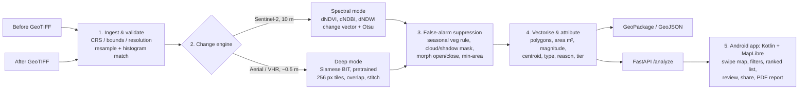

# GEOAI 04: Bi-temporal Change Detection that Separates Real Change from False Alarms

**FUSION 2026 | GeoAI track | Problem statement GEOAI 04 | Team Slothdev**

> Upload a "before" and an "after" image of the same place. Within a minute or two, get a map of what actually changed (new buildings, vegetation loss, flooding), with seasonal and lighting noise filtered out. Each change is ranked by how much it matters and explained in one line, and the whole layer exports as a file that opens in QGIS.

---

## Contents

1. [Where this document comes from](#1-where-this-document-comes-from)
2. [The problem](#2-the-problem)
3. [Who it is for](#3-who-it-is-for-stakeholders)
4. [Our approach in one paragraph](#4-our-approach-in-one-paragraph)
5. [Architecture](#5-architecture)
6. [The pipeline, stage by stage](#6-the-pipeline-stage-by-stage)
7. [Output format and severity tiers](#7-output-format-and-severity-tiers)
8. [The end product](#8-the-end-product-what-the-user-sees-and-does)
9. [What makes it a winning solution](#9-what-makes-it-a-winning-solution)
10. [Proof so far: the worked example](#10-proof-so-far-the-worked-example)
11. [Tech stack](#11-tech-stack)
12. [Datasets and pretrained models](#12-datasets-and-pretrained-models)
13. [API design](#13-api-design)
14. [Evaluation plan](#14-evaluation-plan)
15. [Build plan](#15-build-plan)
16. [Team split](#16-team-split)
17. [Risks and mitigations](#17-risks-and-mitigations)
18. [Proposed additions: small features that make it stand out](#18-proposed-additions-small-features-that-make-it-stand-out)
19. [Demo script](#19-demo-script)
20. [Likely judge questions](#20-likely-judge-questions-and-our-answers)
21. [Repository layout](#21-repository-layout)
22. [Open questions](#22-open-questions)
23. [Glossary](#23-glossary)
24. [References](#24-references)

---

## 1. Where this document comes from

This document is built from the team's planning conversation about GEOAI 04 (the "Fourth GeoAI problem statement plan" chat). That chat covered:

- the execution plan (architecture, build order, team split, risks)
- what the winning end product should look like and do
- a worked example, where the pipeline ran on real before/after image pairs and produced measured results

The build is split into two plan files: [`FRONTEND_PLAN.md`](../FRONTEND_PLAN.md) and [`BACKEND_PLAN.md`](../BACKEND_PLAN.md).

**The product is an Android app** (Kotlin + Jetpack Compose + MapLibre Android) backed by a Python/FastAPI processing service. The build is split into two plan files: [`FRONTEND_PLAN.md`](../FRONTEND_PLAN.md) (the Android app) and [`BACKEND_PLAN.md`](../BACKEND_PLAN.md) (pipeline + API).

Sections 2 to 17 and 19 to 20 restate and expand that plan. **Section 18 is new.** It proposes small, practical additions.

> **Note on the problem statement text.** The official GEOAI 04 PDF was attached to that chat, but the attachment is not part of the shared copy. Section 2 is reconstructed from the "expected solution" points we worked from. **Paste the official wording into section 2.1 before submission** and check that every requirement is covered.

---

## 2. The problem

### 2.1 Official statement

> _Paste the official FUSION 2026 GEOAI 04 text here (title, background, expected solution, deliverables, evaluation criteria)._

### 2.2 The problem in our words

Governments, disaster agencies and city planners regularly need to know **what changed on the ground between two dates**. Examples are new illegal construction on a lake bed, buildings destroyed by a cyclone, a forest patch cleared, or a flood that spread into farmland.

Satellite and aerial images cover this, but comparing two images is harder than it sounds:

- **Most pixel-level change is not real change.** Crops grow and are harvested, trees change colour with the season, the sun is at a different angle, shadows move, clouds and haze appear, and two sensors record slightly different colours. A naive "subtract the two images" approach flags large parts of every scene.
- **Analysts drown in false alarms.** If a tool raises 400 alerts and 360 of them are seasonal grass, nobody trusts it. The real changes get missed.
- **A raw pixel mask is not usable output.** The people acting on it work in GIS tools (QGIS, ArcGIS). They need **polygons** with an area, a location and a priority, not a black-and-white image.

### 2.3 What the expected solution asks for

From the expected-solution points we planned against:

| # | Requirement | Where we cover it |
|---|---|---|
| R1 | Accept co-registered GeoTIFF image pairs (before / after) | §6.1 |
| R2 | Detect change with a Siamese deep model and/or a spectral index method | §6.2 |
| R3 | Suppress false alarms (seasonal, illumination, cloud, noise) | §6.3 |
| R4 | Clean the mask with morphological filtering | §6.3 |
| R5 | Vectorise to polygons (Rasterio) | §6.4 |
| R6 | Give every polygon its **area**, **change magnitude** and **centroid** | §6.4, §7 |
| R7 | Group changes into **severity tiers** | §7.2 |
| R8 | Show results on a **before/after split-view map** | §8 |
| R9 | Export GIS-ready output | §7.1 |

**The core challenge is separating critical change from false alarms.** Every design choice below serves that.

---

## 3. Who it is for (stakeholders)

| Stakeholder | What they need from us |
|---|---|
| **Disaster management authorities** (NDMA, state SDMAs, district control rooms) | Fast damage maps after floods, cyclones and landslides; a ranked list of where to send teams first; a one-page report to forward up the chain |
| **Municipal corporations and urban development authorities** | Detect unauthorised construction and encroachment on lakes, drains, green belts and government land |
| **Forest and environment departments** | Spot clearing, mining scars and loss of green cover in protected zones |
| **Revenue and land-records departments** | Evidence of land-use change on specific parcels |
| **GIS analysts** (the hands-on user in all of the above) | Polygons they can open in QGIS or ArcGIS, with attributes, few false alarms, and a reason for every detection |
| **Field verification teams** | The exact location of each change, with directions, on a phone |
| **Researchers, NGOs, journalists** | Reproducible, explainable change statistics for an area |

---

## 4. Our approach in one paragraph

**We do not train a model from scratch.** In a hackathon that is the slowest and riskiest path. We use:

- **a pretrained Siamese change-detection model** (BIT, trained on LEVIR-CD) for high-resolution imagery
- **a training-free spectral method** (NDVI / NDBI / NDWI differences) for Sentinel-2

We spend our effort where the problem statement puts its weight: **false-alarm suppression**, **attributed GIS-ready polygons**, **severity ranking**, and a **map UI that proves it**.

---

## 5. Architecture



**Two modes, each on the resolution it was built for.** A model trained on 0.5 m imagery does not work on 10 m imagery, so we never mix them (see §17).

| | Spectral mode | Deep mode |
|---|---|---|
| Input | Sentinel-2 L2A (10 m, multispectral incl. NIR/SWIR) | High-resolution RGB aerial / satellite (≈0.3–1 m) |
| Method | Index differences + change-vector magnitude, Otsu threshold | Siamese transformer (BIT) pretrained on LEVIR-CD |
| Training needed | None | None (published weights) |
| Detects | Built-up gain, vegetation loss, water gain/loss (floods) | Building construction / demolition |
| Works where | Anywhere on Earth, free data every ~5 days | Where VHR imagery is available |
| Speed | Very fast (array maths) | ~7 s on CPU for 11 tiles of 256 px (measured) |

---

## 6. The pipeline, stage by stage

### 6.1 Ingest and validate (Rasterio)

- Accept two GeoTIFFs (or a demo pair picked from a list).
- **Check** that CRS, bounds and resolution match. If they don't, **resample** the after image onto the before image's grid (`rasterio.warp.reproject`).
- **Radiometric normalisation:** histogram-match the after image to the before image (`skimage.exposure.match_histograms`). This removes most sun-angle and exposure differences before any comparison.
- **Large scenes:** use windowed reads (`rasterio.windows`) so nothing runs out of memory.

### 6.2 Change engine

**Spectral mode (Sentinel-2):**

- Compute, per date:
  - NDVI = (NIR − Red) / (NIR + Red)
  - NDBI = (SWIR1 − NIR) / (SWIR1 + NIR)
  - NDWI = (Green − NIR) / (Green + NIR)
- Take the differences dNDVI, dNDBI and dNDWI, plus the change-vector magnitude across bands.
- Threshold each with **Otsu's method**. It needs no training and adapts per scene.
- The index that moved determines the **change type**:
  - NDBI up and NDVI down → *built-up gain*
  - NDVI down alone → *vegetation loss*
  - NDWI up → *water gain / flooding*

**Deep mode (high-res):**

- Siamese **BIT** (Bitemporal Image Transformer) or FC-Siam-diff, using public LEVIR-CD weights.
- Run on 256 px tiles with overlap, then stitch the probability maps back to the full scene.
- Output a per-pixel change probability (0–1). Threshold it at 0.5.

### 6.3 False-alarm suppression (our differentiator)

| Source of false alarm | Rule |
|---|---|
| Seasonal vegetation (crops, deciduous trees) | Drop pixels where NDVI changed but the built-up index did not |
| Clouds and cloud shadows | Mask using Sentinel-2's **Scene Classification Layer (SCL)** band |
| Illumination / sensor differences | Histogram matching at ingest (§6.1) |
| Speckle and tiny blobs | Morphological **open** then **close** (5×5 ellipse kernel) |
| Slivers too small to matter | **Minimum-area filter** (default 20 m², configurable) |

Every dropped region is counted, so the UI can show something like "412 raw detections → 37 after filtering" (see §9).

### 6.4 Vectorise and attribute (Rasterio, Shapely, GeoPandas)

- Convert the mask to polygons with `rasterio.features.shapes`, then simplify them (`shapely.simplify`, tolerance ≈ 1 pixel).
- **Reproject to the local UTM zone** to compute true area in m².
- Attach these attributes to each polygon: mean change magnitude, centroid lat/lon, change type, the reason it was kept, and severity tier (§7).
- Sort by severity score.

### 6.5 Output and UI

- Export **GeoPackage** (for QGIS / ArcGIS / QField) and **GeoJSON** (for the app and web tools).
- **FastAPI** backend with an `/analyze` endpoint (§13).
- **Android app** (Kotlin, Jetpack Compose, MapLibre Android SDK) (§8, [`FRONTEND_PLAN.md`](../FRONTEND_PLAN.md)).

---

## 7. Output format and severity tiers

### 7.1 Polygon attributes (every feature in the GeoJSON / GeoPackage)

| Field | Type | Example | Meaning |
|---|---|---|---|
| `id` | int | 1 | Rank by severity within the run |
| `scene` | str | `test_2_0000_0000` | Source scene / job id |
| `area_m2` | float | 3229.0 | Area computed in local UTM |
| `magnitude` | float 0–1 | 0.91 | Mean change probability (deep) or normalised change-vector magnitude (spectral) |
| `centroid_lat`, `centroid_lon` | float | 30.274585, −97.724737 | WGS84 centroid |
| `change_type` | str | `built_up_gain` | `built_up_gain`, `vegetation_loss`, `water_gain`, `demolition`, `other` |
| `reason` | str | "built-up index rose, vegetation fell" | Why the polygon was kept (explainability) |
| `score` | float | 992.1 | `area_m2 × magnitude` |
| `tier` | str | `high` | `low`, `medium`, `high`, `critical` |
| `review_status` | str | `confirmed` | `pending`, `confirmed`, `dismissed` (analyst review, §9) |

### 7.2 Severity tiers

Score = `area_m2 × magnitude`.

| Tier | Score | Colour |
|---|---|---|
| Critical | ≥ 1000 | `#b5179e` |
| High | 300 – 999 | `#e03131` |
| Medium | 120 – 299 | `#f08a24` |
| Low | < 120 | `#f2c744` |

These thresholds are **starting values** we picked for the worked example. Tune them to the judges' rubric and the use case. A flood response team and a municipal encroachment cell care about different sizes. Making the thresholds configurable per use case is proposed in §18.

---

## 8. The end product: what the user sees and does

### 8.1 User flow

1. **Pick an area on the map and two dates** (the app fetches Sentinel-2 scenes), **upload** two GeoTIFFs, **or pick a ready demo scene** (one flood case, one encroachment case).
2. **Wait briefly.** A progress bar shows the stages: *aligning → detecting → filtering → vectorising*.
3. **Explore** the result on the split-view map.
4. **Review** each change: confirm or dismiss it.
5. **Share** the change layer (GeoPackage / GeoJSON), a one-page PDF summary and a field pack through the Android share sheet.

### 8.2 Screen layout (Android app)

The product is an **Android app** (Kotlin, Jetpack Compose, MapLibre Android SDK). The full screen list, the reasons for choosing Kotlin and the build phases are in [`FRONTEND_PLAN.md`](../FRONTEND_PLAN.md).

_Numbers in this mock-up are illustrative._

```
 ┌─────────────────────┐   ┌─────────────────────┐
 │ ≡  Pune East  [◉ F] │   │ ▔▔▔                 │
 │ BEFORE  ┃  AFTER    │   │ #2  HIGH            │
 │         ┃ ▓▓  ▓     │   │ built-up gain       │
 │      ◀━━╋━━▶  ▓▓    │   │ 1,089 m² · conf 0.91│
 │         ┃    ▓      │   │ 30.274585,-97.724737│
 │ 412 raw → 37 real   │   │ "built-up index     │
 ├─────────────────────┤   │  rose, vegetation   │
 │ ▔▔▔ (drag up)       │   │  fell"              │
 │ 1 ■ 3,229 m² CRIT   │   │ [before] [after]    │
 │ 2 ■ 1,089 m² HIGH   │   │ inside lake buffer  │
 │ 3 ■   651 m² HIGH   │   │ [✓ Confirm][✗ Dism.]│
 │ [All|Review|✓|✗]    │   │ [➤ Navigate]        │
 └─────────────────────┘   └─────────────────────┘
   Result map + list           Change detail sheet
```

- **The map (full screen):** two synced maps with a draggable swipe divider: before on the left, after on the right. Change polygons are drawn on top in the four tier colours.
- **False-alarm toggle** on the map with a "412 raw → 37 real" counter.
- **Bottom sheet:** collapsed, it shows the summary (total area, counts per tier and type). Expanded, it shows the ranked list. Tapping a row flies the map to that polygon.
- **Detail sheet on tap:** area, magnitude, confidence, centroid, type, tier, reason, before/after crops, zone/permit/ward chips, confirm/dismiss, and **Navigate** (Google Maps).
- **Filter sheet:** tier and type chips, minimum-area and confidence sliders, applied live.
- **Share sheet:** GeoPackage, GeoJSON, PDF and field pack, through the Android share sheet (WhatsApp, email, Drive, QField).

---

## 9. What makes it a winning solution

The statement's real problem is separating critical change from false alarms, so the strongest features are the ones that **prove** we did that:

1. **A "false-alarm filter" toggle.** With it off, the map is covered in seasonal vegetation and lighting noise. With it on, only real structural change remains, and a counter reads e.g. *"412 raw detections, 37 after filtering"*. **This is the best single moment in the demo.**
2. **A reason on every polygon.** Each one says why it was kept, e.g. *"built-up index rose, vegetation fell"*. The output is explainable, not a black box.
3. **Measured accuracy.** Report F1 and IoU on a public test set, plus processing time per km², on an **Accuracy screen inside the app** (`GET /metrics`).
4. **Proof of GIS-readiness.** Share the exported file from the phone and open it in **QGIS on the laptop (or QField on the phone) live during the demo**.
5. **Analyst review.** Confirm and dismiss buttons on each polygon. The export contains only confirmed polygons.
6. **One-page report.** An auto-generated PDF with the map, totals and the top ten changes. This is what an emergency agency would actually forward.

**If time is short:** build (1) and (4) first. Treat (5) and (6) as optional.

> We don't know FUSION's exact judging rubric. Check it and weight these features accordingly.

---

## 10. Proof so far: the worked example

We ran the full pipeline end to end on **real before/after image pairs**. The code is in [`prototype/pipeline.py`](../prototype/pipeline.py), and the figures script is in [`prototype/figures.py`](../prototype/figures.py).

- **Data:** LEVIR-CD sample pairs (Google Earth imagery of Texas, 0.5 m per pixel) shipped with the BIT repository
- **Model:** public BIT checkpoint (`BIT_LEVIR/best_ckpt.pt`), run on CPU
- **Comparison:** a naive baseline (histogram match → pixel difference → Otsu)

### 10.1 Accuracy (7 test tiles, pooled, against human-annotated labels)

| Method | Precision | Recall | F1 | IoU |
|---|---|---|---|---|
| Naive pixel difference (raw) | 0.240 | 0.390 | 0.297 | 0.174 |
| Naive pixel difference + clean-up | 0.264 | 0.341 | 0.298 | 0.175 |
| **Siamese BIT (raw)** | 0.906 | 0.950 | **0.928** | 0.865 |
| **Siamese BIT + clean-up** | 0.904 | 0.951 | **0.927** | 0.864 |

**The pretrained model scores F1 0.93, against 0.30 for naive differencing.**

### 10.2 The main scene (`test_2_0000_0000`, 128 m × 128 m, open scrubland → new housing street)

| Stage | Result |
|---|---|
| Ingest | Both images written as GeoTIFFs on the same grid; Rasterio checks that CRS and grid match |
| Naive baseline | Flags **41%** of the scene in **158 blobs** (grass, trees and roads all changed colour). The reference label says 25% really changed |
| Siamese model | Lights up only the new buildings |
| Clean-up | Threshold 0.5, morphological open/close, drop anything under 20 m² |
| Vectorise | **16 polygons, 4,340 m²** in total |
| Attribute | Area, magnitude (mean probability), centroid lat/lon, tier |

### 10.3 Three more scenes

| Scene | Naive difference | Our pipeline |
|---|---|---|
| Same buildings, different lighting and season | **188 blobs, 20% flagged** | **0 polygons** ✅ |
| Farmland → commercial building | 149 blobs | 1 polygon, 3,229 m², critical |
| Infill housing in an existing estate | 139 blobs | 6 polygons, 2,576 m² |

The first row is the false-alarm demo in miniature. The naive method raises 188 alerts on a scene where nothing was built, and our pipeline raises none.

**Across all 11 labelled tiles** the pipeline produced 90 polygons totalling 29,043 m²: 3 critical, 15 high, 55 medium and 17 low.

**Speed:** about **7 seconds on CPU for 11 tiles**, so a live demo without a GPU is realistic.

### 10.4 What this run does *not* prove (be upfront about these with judges)

- **The accuracy figure is optimistic.** It comes from 7 test tiles that the model's authors picked as samples. The BIT paper's full-test-set F1 on LEVIR-CD is about 0.89.
- **The no-change scene was in the model's training split.** Re-run that demo on a no-change pair the model has not seen before showing it to judges.
- **Coordinates are placeholders.** LEVIR-CD ships as plain PNGs, so the run assigned an origin near Austin (UTM 14N). Areas and shapes are real; lat/lon is illustrative.
- **Touching buildings merge.** In the infill scene, one 1,089 m² polygon is actually a row of houses, which inflates its tier. A fix is proposed in §18.
- **It only sees buildings.** This model ignores floods, vegetation loss and roads. Those need the spectral mode.
- **Spectral mode has not run yet.** These images have no near-infrared band, and Sentinel-2 archives were not reachable from the test environment.
- **Tier thresholds are guesses** (120 / 300 / 1,000). Tune them.

---

## 11. Tech stack

| Layer | Choice | Why |
|---|---|---|
| Language | **Python 3.11+** | The geospatial and ML ecosystem lives here |
| Raster I/O | **Rasterio** (GDAL) | GeoTIFF read/write, reprojection, windowed reads, `features.shapes` vectorisation (named in the statement) |
| Vector | **Shapely 2, GeoPandas, pyproj** | Polygon ops, UTM area, CRS transforms, GPKG/GeoJSON export |
| Image processing | **NumPy, OpenCV, scikit-image** | Histogram matching, Otsu, morphology, connected components |
| Deep learning | **PyTorch** (CPU is enough for the demo), **einops** | BIT inference |
| Change model | **BIT_CD** (pretrained on LEVIR-CD); FC-Siam-diff as an alternative | Published weights, strong F1, no training required |
| Satellite data access | **pystac-client** + Element84 **Earth Search** STAC (Sentinel-2 L2A COGs on AWS); Copernicus Data Space as a fallback | Free, global, cloud-optimised; SCL band for cloud masking |
| Backend | **FastAPI** + Uvicorn; background task for long jobs | Simple, async, auto-generated OpenAPI docs |
| App (frontend) | **Android, Kotlin + Jetpack Compose + MapLibre Android SDK**; Retrofit/OkHttp, kotlinx.serialization, Coroutines/Flow, Coil, DataStore | Native map rendering and swipe compare, native file picker/share sheet; the team already shipped this stack (Dhruva). Comparison with React Native and Flutter in [`FRONTEND_PLAN.md` §1](../FRONTEND_PLAN.md#1-tech-stack-choice-kotlin--jetpack-compose--maplibre-android) |
| Map styles | OpenFreeMap `positron` / `dark` | Free, no API key, avoids a known MapLibre offline-pack crash |
| Imagery for the app | WebP previews (≤ 2048 px) + bounds from the backend; **TiTiler** (COG tiles) if time allows | Show before/after images smoothly on a phone |
| Report | **Matplotlib** for figures + **WeasyPrint** or ReportLab for the PDF | One-page summary export |
| GIS check | **QGIS** (laptop), **QField** (Android) | Live proof that the export is GIS-ready |
| Packaging | `requirements.txt`, **Docker** (optional); release-signed **APK** | Reproducible demo machine and demo phone |
| Quality | pytest, ruff | Keep the pipeline honest while four people edit it |

---

## 12. Datasets and pretrained models

| Name | What it is | Our use |
|---|---|---|
| **LEVIR-CD** | 637 pairs of 1024×1024 Google Earth images at 0.5 m, with building-change labels (Texas, 2002–2018) | Accuracy metrics for deep mode (F1/IoU). Not georeferenced, so **metrics only** |
| **BIT_CD checkpoint** (`BIT_LEVIR/best_ckpt.pt`) | Published weights of the Bitemporal Image Transformer | Deep-mode inference |
| **Sentinel-2 L2A** (via Earth Search STAC / Copernicus) | 10 m multispectral, global, ~5-day revisit, includes the SCL cloud band | Spectral mode, live demo on real Indian locations |
| **OSCD** (Onera Satellite Change Detection) | Sentinel-2 change pairs with labels | Metrics for spectral mode |
| **xBD / xView2** *(optional)* | Pre/post-disaster VHR images with building damage labels | A disaster demo case, if time permits |
| **OpenStreetMap** (Geofabrik extracts / Overpass) | Roads, water bodies, parks, admin boundaries | Context layers for the additions in §18 |

**Demo cases to prepare (two polished ones):**

1. **Urban encroachment:** a fast-growing city edge, or construction on a lake bed or floodplain (e.g. a Bengaluru, Pune or Hyderabad periphery), Sentinel-2 a year apart, same season.
2. **Disaster:** a flood before/after pair from Sentinel-2 (water gain), e.g. a recent monsoon flood in Assam or Kerala.

Keep the season and time of day matched between dates where possible. That is the cheapest false-alarm reduction there is.

---

## 13. API design

Summary only. The full contract, including previews, crops, metrics and Sentinel-2 fetch, is in [`BACKEND_PLAN.md` §5](../BACKEND_PLAN.md#5-api-contract-fastapi-apimainpy).

| Method | Path | Body / params | Returns |
|---|---|---|---|
| `POST` | `/analyze` | multipart: `before` (GeoTIFF), `after` (GeoTIFF), `mode` (`auto`/`spectral`/`deep`), `min_area_m2`, `filter` (bool) | `{ job_id }` |
| `GET` | `/jobs/{job_id}` | | `{ status, stage, progress }` (drives the progress bar) |
| `GET` | `/jobs/{job_id}/result` | | GeoJSON FeatureCollection + `summary` (counts, area, raw vs filtered) |
| `GET` | `/jobs/{job_id}/export` | `format=gpkg|geojson|pdf`, `confirmed_only=true` | File download |
| `PATCH` | `/jobs/{job_id}/features/{id}` | `{ review_status }` | Updated feature |
| `GET` | `/demos` | | List of preloaded demo scenes |

`mode=auto` picks spectral if the input has NIR/SWIR bands and a pixel size of 5 m or more. Otherwise it picks deep.

---

## 14. Evaluation plan

| What | How | Target |
|---|---|---|
| Deep-mode accuracy | F1, IoU, precision, recall on the **LEVIR-CD test split** (not just samples) | Reproduce ≈ 0.89 F1 |
| Spectral-mode accuracy | F1 / IoU on OSCD test cities | Report honestly, whatever it is |
| False-alarm reduction | Raw detections vs after-filter detections on matched-season and mismatched-season pairs; **false alarms per km²** | Show a large drop with no recall loss |
| Unseen no-change pair | Run on a pair not in any training split | ~0 polygons |
| Speed | Seconds per km² on a laptop CPU, per mode | Live-demo friendly (< 2 min per scene) |
| GIS-readiness | Export opens in QGIS with the correct CRS and attributes | Yes / no, shown live |

---

## 15. Build plan

| Phase | Deliverable | Done when |
|---|---|---|
| **1** | Spectral mode end to end on one Sentinel-2 pair, producing GeoJSON | It opens correctly in QGIS |
| **2** | Android app showing that GeoJSON on the swipe map | Swipe, polygons and detail sheet all work on a phone |
| **3** | Deep mode added, F1/IoU reported on the LEVIR-CD test set | Metrics table generated by a script |
| **4** | False-alarm filters, severity tiers, GeoPackage export, filter toggle and counter | Toggle shows raw → filtered |
| **5** | Two polished demo cases (encroachment, disaster), PDF report, analyst review | Demo rehearsed twice |
| **6** *(stretch)* | Additions from §18 | Pick by priority |

**Finish phases 1 and 2 first so we always have a working demo.** Everything after that adds to something that already works.

> We will turn this into an hour-by-hour schedule once we know the hackathon's length and the team size.

---

## 16. Team split

| Role | Owns |
|---|---|
| **Model** | Deep-mode inference (tiling, stitching), metrics on LEVIR-CD, speed benchmarks |
| **Geospatial** | Ingest/validation, spectral mode, false-alarm rules, vectorisation, attributes, tiers |
| **Backend + Android app** | FastAPI jobs and endpoints; the Kotlin app (swipe map, filters, ranked list, detail sheet, review, share) |
| **Data, demo and pitch** | Sourcing and checking image pairs, the with/without-filter comparison, the PDF report layout, slides, demo script, Q&A prep |

Names: _fill in_.

---

## 17. Risks and mitigations

| Risk | Impact | Mitigation |
|---|---|---|
| **Domain gap:** a LEVIR-trained model fails on 10 m Sentinel imagery | Garbage output in deep mode | Keep each mode on its matching resolution; `mode=auto` picks by pixel size |
| **LEVIR-CD is plain PNG, not georeferenced** | Can't show real coordinates | Use it for metrics only; use real GeoTIFFs for the live demo |
| **Large rasters** | Out-of-memory, slow | Windowed reads, tiled inference, downsample for the preview |
| **Misregistered pairs** (a 1–2 px shift) | Edges of every building flagged as change | Grid check at ingest; sub-pixel shift check (§18) |
| **Clouds in the chosen dates** | False alarms, missing data | SCL mask; pick the least-cloudy dates (§18) |
| **Touching buildings merge into one polygon** | Inflated tiers | Watershed split (§18) |
| **Optimistic accuracy claims** | Credibility with judges | Report the full-test-set number and state the limits (§10.4) |
| **Sentinel-2 access blocked at the venue** | No live data | Pre-download the demo scenes; ship them with the app |
| **Old dependencies in BIT_CD** (`torchvision.models.utils`, `torch.load` changes) | Model won't load | Already solved in `prototype/pipeline.py` with a small shim and a `safe_globals` allowlist |

---

## 18. Proposed additions: small features that make it stand out

Each addition below is **small (hours, not days)**, uses data and libraries already in the stack, and answers a real need of a stakeholder in §3. They are ordered by value for effort.

| # | Feature | What it does | Who benefits | Effort | How (in our stack) |
|---|---|---|---|---|---|
| **A1** | **"Authorised vs unauthorised" check** | The user uploads a layer of approved permits or known projects (GeoJSON/Shapefile). Changes that overlap an approved footprint are tagged *authorised* and drop a tier; the rest are flagged *unauthorised* | Municipal corporations, development authorities | ~3–4 h | `geopandas.sjoin` on the result; one extra field `permit_status` |
| **A2** | **No-build zone escalation** | If a change falls inside a sensitive zone (water body, river buffer, forest, park, from OSM or an uploaded layer), its tier is raised by one and the reason says so, e.g. *"new built-up inside lake boundary"* | Municipal, forest and environment departments, courts / NGT cases | ~3 h | OSM water/park polygons + `buffer` + spatial join |
| **A3** | **Ward / village tagging** | Every polygon gets the name of the administrative unit it falls in. The ranked list can then be grouped as "ward 42: 5 critical changes" | Any department that routes work by jurisdiction | ~2 h | Spatial join with OSM `admin_level` boundaries or an uploaded ward map |
| **A4** | **Field verification pack** | One click exports a CSV/KML of confirmed changes, with a Google Maps directions link and the before/after crop for each. It opens on any phone; a QR code on the PDF opens the same list | Field verification teams, disaster response | ~2–3 h | GeoPandas → KML/CSV; `qrcode` lib for the PDF |
| **A5** | **Co-registration shift check** | Before detecting, estimate the sub-pixel shift between the two images. If it exceeds ~1 px, warn the user or auto-correct, so building edges don't show up as false change | GIS analysts (fewer false alarms) | ~1–2 h | `skimage.registration.phase_cross_correlation` + affine shift |
| **A6** | **Least-cloudy date picker** | The user draws an area and gives two target dates. The app queries STAC and picks the Sentinel-2 scenes with the least cloud within ±15 days, preferring the same season | Disaster agencies (fast response), analysts | ~3 h | `pystac-client` search on `eo:cloud_cover`, sort, fetch COG windows |
| **A7** | **Split touching buildings** | Distance-transform + watershed separates a row of houses into individual polygons, fixing the inflated-tier issue seen in §10.4 | Analysts, municipal counts of new structures | ~2 h | `scipy.ndimage.distance_transform_edt` + `skimage.segmentation.watershed` |
| **A8** | **Confidence band + review queue** | Polygons with mid-range magnitude (e.g. 0.5–0.7) go to a "needs review" list, so analysts check only the uncertain ones | Analysts (less review time) | ~1–2 h | One extra field `confidence`; a UI filter |
| **A9** | **Use-case presets** | A dropdown for *Flood response* / *Encroachment* / *Deforestation* that sets the mode, minimum area, active change types and tier thresholds in one click | Non-expert users at agencies | ~1–2 h | A small JSON of presets read by the API and UI |
| **A10** | **Audit trail per run** | Each export carries a JSON sidecar with the input file hashes, image dates, model and version, thresholds and timestamp. The result can be reproduced and defended as evidence | Revenue / legal departments, courts, auditors | ~1 h | `hashlib` + a dict written next to the GPKG |
| **A11** | **Bilingual one-page report** *(stretch)* | The PDF summary in English plus Hindi (or the state language), so it can go straight to district officials | District administrations | ~2–3 h | Template strings + a Devanagari font in WeasyPrint |

**Recommended picks if we only have time for three:** **A2** (no-build zones), **A5** (shift check) and **A4** (field pack).

- **A2** turns "something changed" into "something changed *where it shouldn't*". That is the question a municipal or environment officer actually asks.
- **A5** directly strengthens the core claim of fewer false alarms, at almost no cost.
- **A4** closes the loop from detection to action on the ground, which judges from agencies notice.

**A1** is the strongest single feature for the encroachment demo, if a permits layer (even a mock one) can be prepared.

---

## 19. Demo script

Five minutes, two scenes.

1. **(30 s) The problem.** "Agencies compare before/after images to find illegal construction and disaster damage. Naive methods drown them in false alarms."
2. **(60 s) On the phone (screen-mirrored), open the encroachment scene.** Show the progress stages. The swipe map appears.
3. **(45 s) The moment.** Toggle the false-alarm filter **off**: the map fills with noise, *412 raw detections*. Toggle **on**: *37 remain*. Swipe across one to show it is real.
4. **(30 s) Tap a critical polygon.** Show its area, magnitude, reason, before/after crops and *"inside lake buffer"* (A2). Confirm it.
5. **(30 s) Share.** Share the GeoPackage from the phone and **open it in QGIS** (laptop) or QField live. The attributes are all there.
6. **(45 s) Disaster scene.** Spectral mode, flood → water-gain polygons ranked by size. Download the one-page PDF and field pack (A4).
7. **(30 s) Numbers.** The in-app Accuracy screen: F1/IoU (full test set), the no-change scene giving 0 polygons, and seconds per km² on a laptop CPU.
8. **(30 s) Close.** "Pretrained models, honest metrics, explainable output, GIS-ready from minute one."

**Rehearse on the release APK, with Wi-Fi off.** All demo scenes and model weights should be local, and the app's bundled demo mode is the last-resort fallback.

---

## 20. Likely judge questions and our answers

| Question | Answer |
|---|---|
| Why not train your own model? | Published weights already reach ≈0.89 F1 on LEVIR-CD. Training in a hackathon adds risk without adding value. Our contribution is the false-alarm suppression, attribution and usable output |
| How do you handle seasons? | Same-season date selection, histogram matching, the seasonal-vegetation rule (NDVI changed but the built-up index did not → drop), and the SCL cloud mask |
| Your F1 of 0.93 looks high. | It is on 7 sample tiles. We also report the full test split (≈0.89) and show a no-change pair the model has never seen |
| Does it work in India? | Spectral mode uses Sentinel-2, which is global and free. Our demo scenes are Indian locations. Deep mode needs VHR imagery, which agencies can supply (e.g. from Bhuvan / NRSC or drone surveys) |
| How is severity decided? | Area × magnitude, configurable per use case, raised one tier for no-build zones (A2) |
| Can it scale to a whole district? | Windowed reads, tiled inference and a background job queue. Spectral mode is array maths and very fast; deep mode is ~7 s per 11 tiles on CPU, and a GPU speeds it up by an order of magnitude |
| What can an officer do with the output? | Open it in QGIS, forward the PDF, send the field pack to a ground team, and keep the audit sidecar as evidence |

---

## 21. Repository layout

```
.
├── README.md                ← short project overview and setup
├── FRONTEND_PLAN.md         ← Android app: stack choice, screens, phases, structure, UX rules, done criteria
├── BACKEND_PLAN.md          ← engine modules, API contract, phases, tests, done criteria
├── docs/PROJECT_PLAN.md     ← this document
├── prototype/
│   ├── pipeline.py          ← worked example: ingest → BIT + baseline → clean → vectorise → tiers → GPKG/GeoJSON
│   ├── figures.py           ← stage-by-stage and multi-scene figures
│   └── requirements.txt
└── (planned)
    ├── engine/              ← ingest, spectral, deep, filters, vectorise (from prototype)
    ├── api/                 ← FastAPI app
    ├── app/                 ← Android app (Kotlin + Compose + MapLibre)
    ├── demos/               ← preloaded before/after scenes
    └── eval/                ← metric scripts and results
```

**Running the prototype:**

```bash
git clone --depth 1 https://github.com/justchenhao/BIT_CD.git   # includes samples + checkpoint
pip install -r prototype/requirements.txt
python prototype/pipeline.py ./BIT_CD ./out    # → out/changes_all.gpkg, out/changes_all.geojson, out/summary.json
python prototype/figures.py ./out              # → out/walkthrough.png, out/more_cases.png
```

---

## 22. Open questions

- [ ] Paste the official GEOAI 04 statement and the judging rubric into §2.1, and re-check §2.3.
- [ ] Hackathon duration and team size, for the hour-by-hour schedule.
- [ ] Is high-resolution imagery provided by the organisers, or do we bring our own?
- [ ] Are there mandated output formats or a required tech stack?
- [ ] Which demo locations: one encroachment and one flood, with exact dates.
- [ ] Which of the §18 additions to commit to (recommended: A2, A5, A4).

---

## 23. Glossary

| Term | Meaning |
|---|---|
| **Bi-temporal** | Two images of the same place at two different times |
| **Co-registered** | Both images aligned pixel-for-pixel on the same grid and CRS |
| **CRS** | Coordinate reference system, e.g. WGS84 (EPSG:4326) or UTM |
| **UTM** | A metric map projection used to compute true areas in m² |
| **GeoTIFF / COG** | A TIFF image with georeferencing / a cloud-optimised version readable in windows over HTTP |
| **GeoPackage (GPKG)** | An open single-file GIS vector format, opened natively by QGIS and ArcGIS |
| **NDVI / NDBI / NDWI** | Normalised difference vegetation / built-up / water indices |
| **Otsu threshold** | An automatic method for picking the cut-off that best splits an image into two classes |
| **Siamese network** | A network with two shared-weight branches that compares two inputs |
| **BIT** | Bitemporal Image Transformer, a Siamese change-detection model |
| **LEVIR-CD** | A public building change-detection dataset |
| **SCL** | Sentinel-2 Scene Classification Layer: per-pixel cloud, shadow, water and vegetation classes |
| **F1 / IoU** | Accuracy measures: the harmonic mean of precision and recall / intersection over union of predicted and true change |
| **Morphological open/close** | Image operations that remove small specks (open) and fill small holes (close) |

---

## 24. References

- Chen, H., Qi, Z., Shi, Z. *Remote Sensing Image Change Detection with Transformers* (BIT), IEEE TGRS 2021. Code and weights: <https://github.com/justchenhao/BIT_CD>
- Chen, H., Shi, Z. *A Spatial-Temporal Attention-Based Method and a New Dataset for Remote Sensing Image Change Detection* (LEVIR-CD), Remote Sensing 2020.
- Daudt, R. C., Le Saux, B., Boulch, A. *Fully Convolutional Siamese Networks for Change Detection* (FC-Siam-diff), ICIP 2018.
- Daudt, R. C. et al. *Urban Change Detection for Multispectral Earth Observation Using Convolutional Neural Networks* (OSCD), IGARSS 2018.
- Sentinel-2 L2A on AWS via Earth Search STAC: <https://earth-search.aws.element84.com/v1>
- Rasterio: <https://rasterio.readthedocs.io> · GeoPandas: <https://geopandas.org> · MapLibre Android SDK: <https://maplibre.org>
