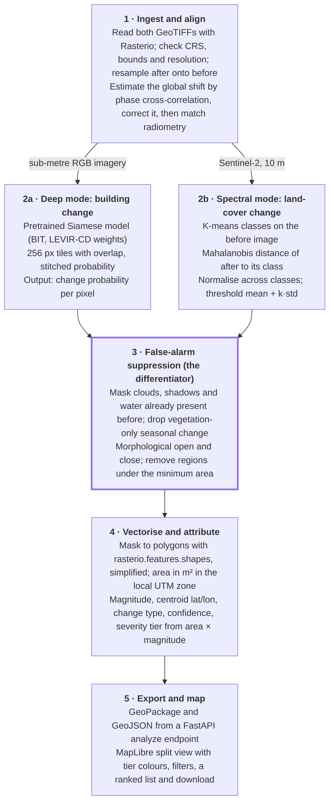
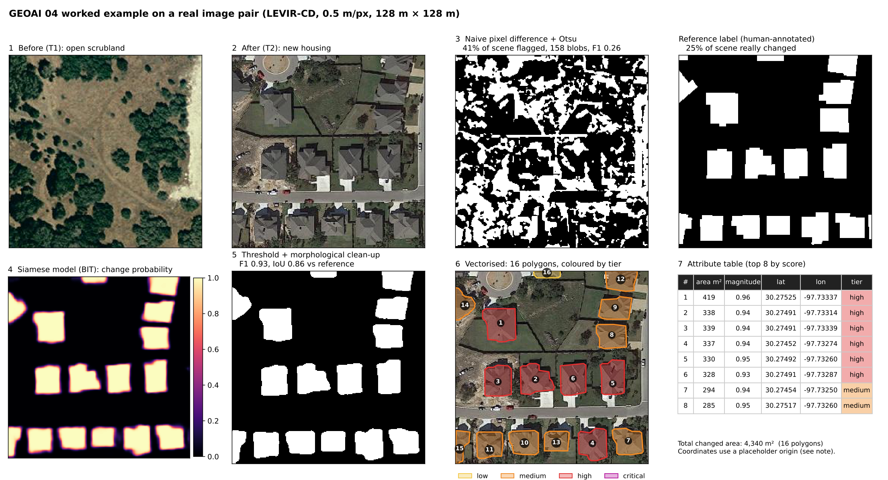
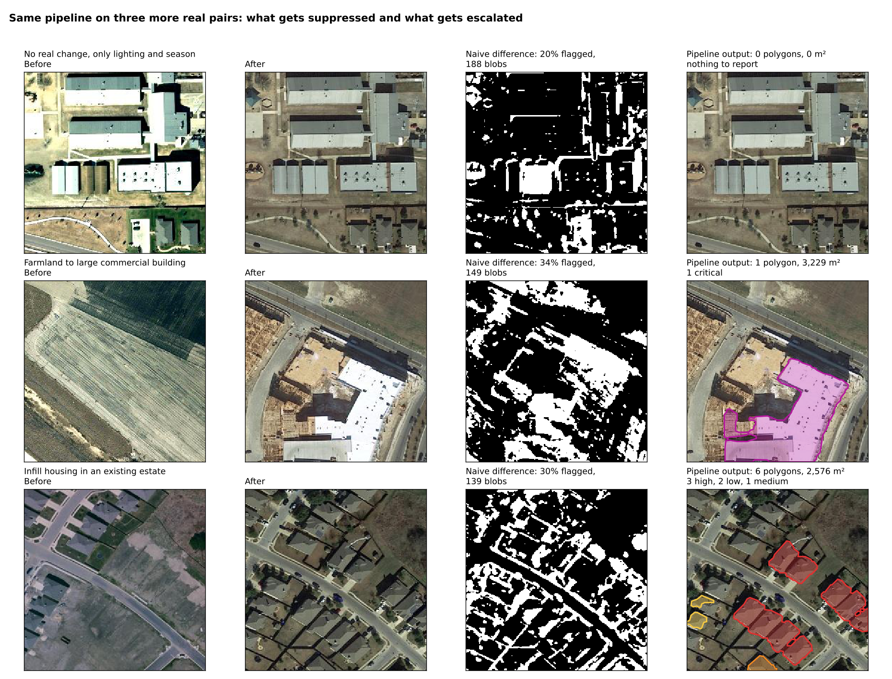

# GEOAI 04 research notes: bi-temporal change detection

Oct 9, 2026

## Summary

Build a two-mode change detector whose real product is the filtered, attributed polygon layer, not the model. A pretrained Siamese network handles building change in sub-metre imagery; an unsupervised, class-aware anomaly score handles floods, fires, landslides and vegetation loss in Sentinel-2. Both feed the same clean-up, vectorising and severity-tier steps.

In a test run on real image pairs, the pretrained Siamese model scored F1 0.93 against human labels, where naive pixel differencing scored 0.30. On a scene with no real change, naive differencing raised 188 false alerts and the pipeline raised none.

Three decisions follow from the research:

- **Do not train from scratch.** Pretrained weights plus an unsupervised baseline are enough; spend the time on false-alarm filtering and GIS output.
- **Make false-alarm suppression the demo.** A filter toggle showing "hundreds of raw detections, a few dozen after filtering" answers the problem statement directly.
- **Check registration before detecting.** Two of the four papers show that small misalignment between the images is the largest single source of false change.

## Problem and target product

GEOAI 04 asks for a tool that takes a before and an after image of the same area and returns what actually changed, ranked by how much it matters, in a form a GIS analyst can use directly. The hard part is separating critical change from false alarms caused by season, lighting and misalignment.

The expected solution, as discussed, has six parts:

1. Accept co-registered GeoTIFF pairs.
2. Detect change with a Siamese model or a spectral index.
3. Clean the mask with morphological filtering and vectorise it with Rasterio.
4. Give every polygon its area, change magnitude and centroid.
5. Group polygons into severity tiers.
6. Show them on a before/after split-view map.

### What the user does

1. Uploads two GeoTIFFs, or picks a ready demo scene.
2. Watches a progress bar through four stages: aligning, detecting, filtering, vectorising.
3. Explores the result on a split-view map.
4. Exports the change layer and a summary.

### What the screen shows

| Area | Contents |
| --- | --- |
| Centre | Map with a draggable swipe divider (before left, after right) and change polygons in four severity colours |
| Left panel | Total changed area, polygon count per tier, breakdown by change type, tier and type filters, minimum-area slider |
| Right panel | Polygons ranked by severity; clicking one flies the map to it |
| Popup | Area in m², magnitude, centroid, type, tier, and before/after crops of that polygon |
| Top bar | Download as GeoPackage or GeoJSON |

### What would make it a winning version

- **False-alarm filter toggle.** Off shows the raw noise; on shows only real change, with a counter of detections before and after.
- **A reason on every polygon**, for example "built-up index rose, vegetation fell".
- **Measured accuracy**: F1 and IoU on a public test set, plus processing time per km².
- **GIS-readiness shown live**: open the exported file in QGIS during the demo.
- **Analyst review**: confirm or dismiss buttons, with only confirmed polygons exported.
- **One-page report**: map, totals and the top ten changes as a PDF.

The filter toggle and the QGIS check come first; the last two are optional if time is short.

## Architecture

Each mode runs only on the resolution it suits, and everything after detection is shared, so the filtering and GIS work is built once.

A LEVIR-trained model fails on 10 m imagery, and the spectral method cannot separate individual buildings, which is why the two modes are kept apart.

### What the papers changed in this design

| Stage | Change | Source |
| --- | --- | --- |
| Ingest | Add a shift estimate and correction; report the residual offset | Goudemant et al., Byun et al. |
| Ingest | Fit radiometric normalisation on stable pixels such as roads and roofs, as an upgrade to histogram matching | Byun et al. |
| Spectral mode | Replace per-pixel differencing with a per-class Mahalanobis score and cross-class normalisation | Tang et al. |
| Spectral mode | Threshold at mean + k × standard deviation (k of 1.5 or 2), exposed as a sensitivity slider | Tang et al. |
| Filtering | Mask water already present in the before image; optional proximity-to-water rule for floods | Byun et al. |
| Attributes | One tier per polygon by majority vote, plus a confidence value | Goudemant et al., Tang et al. |
| Fallback | Pretrained feature differencing (VGG-19) where neither mode transfers | Raju et al. |

## Worked example on real image pairs

The deep mode was run end to end on 11 real before/after pairs and reached F1 0.93 on the seven test tiles, in about 7 seconds on CPU. The pairs are LEVIR-CD samples (Google Earth imagery of Texas, 0.5 m per pixel), and the model is BIT with its published weights, both from the [BIT\_CD repository](https://github.com/justchenhao/BIT_CD).

### One scene, stage by stage

A 128 m × 128 m patch went from open scrubland to a housing street.

1. **Ingest.** Both images are written as GeoTIFFs on one grid and read back with Rasterio, which checks that CRS and grid match.
2. **Naive baseline.** Histogram-match, subtract and Otsu-threshold. It flags 41% of the scene in 158 blobs, because grass, trees and roads all changed colour.
3. **Siamese model.** It outputs a change probability per pixel and lights up only the new buildings.
4. **Clean-up.** Threshold at 0.5, morphological open and close, drop anything under 20 m².
5. **Vectorise.** The mask becomes 16 polygons totalling 4,340 m².
6. **Attribute.** Each polygon gets area, mean probability as magnitude, centroid and a tier from area × magnitude.

### Accuracy against the human labels

Pooled over the seven test-split tiles, change class only.

| Method | Precision | Recall | F1 | IoU |
| --- | --- | --- | --- | --- |
| Naive difference, raw | 0.240 | 0.390 | 0.297 | 0.174 |
| Naive difference, cleaned | 0.264 | 0.341 | 0.298 | 0.175 |
| Siamese model, raw | 0.906 | 0.950 | 0.928 | 0.865 |
| Siamese model, cleaned | 0.904 | 0.951 | 0.927 | 0.864 |

Morphological clean-up alone does not rescue the naive method; the gain comes from the detector.

### Three more scenes

| Scene | Naive difference | Pipeline output |
| --- | --- | --- |
| Same buildings, different lighting and season | 188 blobs, 20% flagged | 0 polygons |
| Farmland to commercial building | 149 blobs, 34% flagged | 1 polygon, 3,229 m², critical |
| Infill housing in an existing estate | 139 blobs, 30% flagged | 6 polygons, 2,576 m² |

### What this run does not prove

- **The accuracy figure is optimistic.** It comes from seven tiles the model's authors chose as samples; the paper's full-test-set F1 is about 0.89.
- **The no-change scene was in the model's training split.** Repeat that demo on a no-change pair the model has not seen.
- **Coordinates are placeholders.** LEVIR-CD ships as plain PNGs, so an origin near Austin was assigned. Areas and shapes are real; latitude and longitude are not.
- **Touching buildings merge.** In the infill scene one 1,089 m² polygon is a row of houses, which inflates its tier.
- **The model only sees buildings.** Floods, vegetation loss and roads need the spectral mode.
- **The spectral mode was not run.** These images have no near-infrared band, and Sentinel-2 archives were not reachable from the test environment.
- **Tier thresholds are provisional**: 120, 300 and 1,000 on the area × magnitude score.

## Literature review

Four sources were read in full; the Shield paper is the most useful because it targets false alarms without training labels.

| Source | What it is | Use for GEOAI 04 |
| --- | --- | --- |
| [Tang et al. 2026, "Shield"](https://doi.org/10.34133/remotesensing.0929) | Unsupervised disaster change detection by per-class anomaly scoring | Core of the spectral mode |
| [Goudemant et al. 2026](https://arxiv.org/abs/2609.37013) | Siamese building damage detector for on-board satellites, on xBD | Registration handling, object-level tiers |
| [Byun, Han and Chae 2015](https://doi.org/10.3390/rs70810347) | Flood extent from bi-temporal KOMPSAT-2 images | Flood case, normalisation, thresholding |
| [Raju et al. 2022](https://www.slideshare.net/slideshow/aibased-change-detection-for-disaster-identification-utilizing-bi-temporal-satellite-images/253832280) | Student paper: VGG-19 feature differencing plus a disaster-type classifier | Fallback method, xBD pointer |

### Tang et al. (2026): Shield

Shield compares each after pixel with the before statistics of its own land-cover class, not with the same pixel. Seasonal and lighting shifts move a whole class together, so they stop registering as change.

| Where | Finding | How to use it |
| --- | --- | --- |
| Methods, Step 1, Fig. 4 | Cluster the before image into classes and fit a Gaussian to each class's features | K-means on the before image; store a mean and covariance per class |
| Step 2, Eq. 4 | Score each after patch by Mahalanobis distance to its class distribution | This is the change magnitude; Euclidean distance cost 9.33% F1 |
| Eqs. 5–6, Fig. 11 | Normalise scores across classes before one global threshold | Required: removing it cost 47.28% F1 and recall fell to 6.25% |
| Parameter analysis, Fig. 13 | Threshold is mean + k × standard deviation, k of 1.5 or 2 | Expose k as a sensitivity slider |
| Parameter analysis | 4 to 6 classes; 3×3 patches at 3 m, 13×13 below 1 m | Starting values |
| Experiments I and II | One model handled landslide, flood, wildfire and deforestation; F1 66.40% (flood) and 91.77% (wildfire) | Covers the non-building changes the deep mode ignores |
| Table 2, Fig. 9 | 510 km² processed in about 90 s; change-vector analysis had 52.83% precision on the flood | Baseline comparison and a speed target |
| Uncertainty analysis, Fig. 15 | Monte Carlo dropout gives an uncertainty map, highest at boundaries and false positives | Confidence attribute per polygon |
| Discussion | A cloud-free before image is made by median-compositing partly cloudy ones | Cloud handling for Sentinel-2 |

Limits to state in the pitch:

- Performance drops when change covers more than about 30% of the scene, and it is largely ineffective above 50%.
- It misses change that resembles the before class; a landslide on bare land had 6.41% recall.
- It loses pixels at the edges of change areas.
- It was tested on 3 m PlanetScope and 0.59 m Google Earth imagery; Sentinel-2 is described as workable in theory only.

Code: [github.com/tangkai-RS/Shield](https://github.com/tangkai-RS/Shield).

### Goudemant et al. (2026): on-board building damage assessment

Most of the paper concerns satellite hardware and can be skipped; four points transfer.

- **One label per building (Section 2).** Pixel-wise damage labels become inconsistent when only part of a structure is damaged, so each polygon gets a single tier.
- **Siamese beats stacking (Section 3.2, Table 2).** A shared encoder with concatenated features plus their difference scored 56.6% mAP against 55.1% for stacking both images at the input.
- **Misregistration is the main failure (Section 4.3, Fig. 3).** Without shift handling, accuracy collapses within a few tens of pixels of offset. Estimating one global shift by cross-correlation held 49.4% mAP at a 400-pixel shift, against 26.6% for augmentation alone.
- **Resampling conventions matter (Section 4.4).** A mismatch shifted features by a fraction of a cell and cost 3.24 points, so check for half-pixel offsets when resampling.

The best damage score on xBD is 57.8% mAP, so accurate four-level damage grading should not be promised.

### Byun, Han and Chae (2015): flood extent

| Where | Finding | How to use it |
| --- | --- | --- |
| Section 1, p. 10349 | Plain difference images produce heavy noise from radiometric and geometric differences | The stated reason the pipeline exists |
| Section 2, p. 10350 | Off-nadir angles of 2° and 24°; images co-registered to about 0.5 pixel RMSE | Registration check at ingest |
| Section 3.2 | Radiometric normalisation by regression on 10 pseudo-invariant features | Fit on stable pixels such as roads and roofs |
| Section 3.2 | Water is very dark in near-infrared | NIR or NDWI as the flood signal |
| Section 3.4 | A windowed similarity index (64-pixel window) resists noise better than per-pixel differencing | A training-free change score; SSIM is a close relative |
| Section 3.5 | Threshold from a two-class Gaussian mixture fitted with EM, initialised from Otsu | Alternative to plain Otsu, with a per-pixel probability |
| Sections 3.3 and 4 | Separates newly flooded land from permanent water | Mask water present in the before image |
| Table 2 | Change-vector analysis and MAD missed 96.32% and 99.96% of the flood; proposed method 75.04% overall accuracy, supervised SVM 76.17% | Report omission and commission error; use as baselines |
| p. 10357 | Remaining false positives sit far from the river | Proximity-to-water rule |

The pan-sharpening and cross-fusion steps need a panchromatic band, which Sentinel-2 does not have.

### Raju et al. (2022): disaster identification

Three ideas are usable:

- **Pretrained feature differencing.** VGG-19 features of both images, squared difference, Otsu threshold: a deep change map with no training.
- **The xBD dataset.** Pre- and post-disaster pairs with four building damage levels (no damage, minor, major, destroyed), which map onto four severity tiers.
- **The user flow.** Upload a pair, get a change map and a percent-changed figure.

Its results should not be cited. The "over ninety percent" figure comes from manual checking, the test table uses placeholder values, and the sample output says "Wildfire" from a classifier trained only on hurricane and earthquake. It has no georeferencing, polygons or GIS export.

## Build order, team split and risks

Finish phases 1 and 2 first so there is always a working demo.

| Phase | Deliverable |
| --- | --- |
| 1 | Spectral mode end to end on one Sentinel-2 pair, producing GeoJSON that opens in QGIS |
| 2 | Split-view web map showing that GeoJSON |
| 3 | Deep mode added, with F1 and IoU reported on the LEVIR-CD test set |
| 4 | False-alarm filters, shift check, severity tiers, GeoPackage export |
| 5 | Two polished demo cases: one urban encroachment, one disaster (xBD) |

### Team split for four people

| Role | Owns |
| --- | --- |
| Model | Deep mode inference and metrics |
| Geospatial | Ingest, spectral mode, vectorisation, attributes |
| Backend and frontend | FastAPI and the map UI |
| Data, demo and pitch | Image pairs, slides, the with/without-filter comparison |

### Risks

- **Domain gap.** A LEVIR-trained model fails on 10 m Sentinel imagery, so each mode stays on its matching resolution.
- **LEVIR-CD is not georeferenced.** Use it for metrics only, and real GeoTIFFs for the live demo.
- **Large tiles.** Use windowed reads so nothing runs out of memory.
- **Misregistration.** A few tens of pixels of offset is enough to break detection; check and correct at ingest.
- **Spectral mode on Sentinel-2 is unproven.** The Shield paper did not test at 10 m, so prototype it early.
- **Merged polygons.** Adjacent buildings fuse into one polygon and inflate its tier; split them or cap the tier by building count.

## Open questions

- [ ] How long is the hackathon, and how many people are on the team?
- [ ] What are FUSION's judging criteria, and how are they weighted?
- [ ] Which demo areas will be used for the encroachment and disaster cases?
- [ ] Does the light version of Shield hold up on Sentinel-2 at 10 m?
- [ ] What tier thresholds match what the judges or an emergency agency would care about?

## Sources

- FUSION 2026 GeoAI problem statements (GEOAI 01 to 05), supplied as a PDF
- [Tang et al. (2026), Journal of Remote Sensing 6, 0929](https://doi.org/10.34133/remotesensing.0929)
- [Goudemant et al. (2026), arXiv:2609.37013](https://arxiv.org/abs/2609.37013)
- [Byun, Han and Chae (2015), Remote Sensing 7, 10347–10363](https://doi.org/10.3390/rs70810347)
- [Raju et al. (2022), IRJET 9(7), via SlideShare](https://www.slideshare.net/slideshow/aibased-change-detection-for-disaster-identification-utilizing-bi-temporal-satellite-images/253832280)
- [BIT\_CD repository: model, weights and sample pairs](https://github.com/justchenhao/BIT_CD)
- [Shield code repository](https://github.com/tangkai-RS/Shield)
